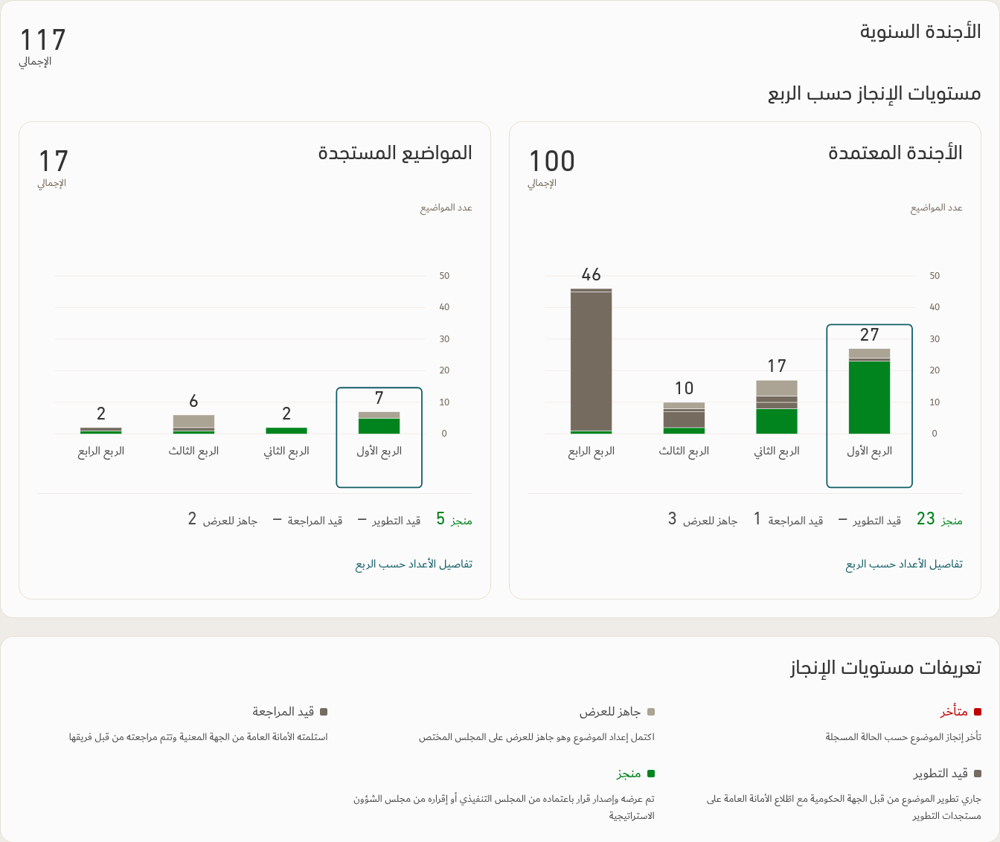
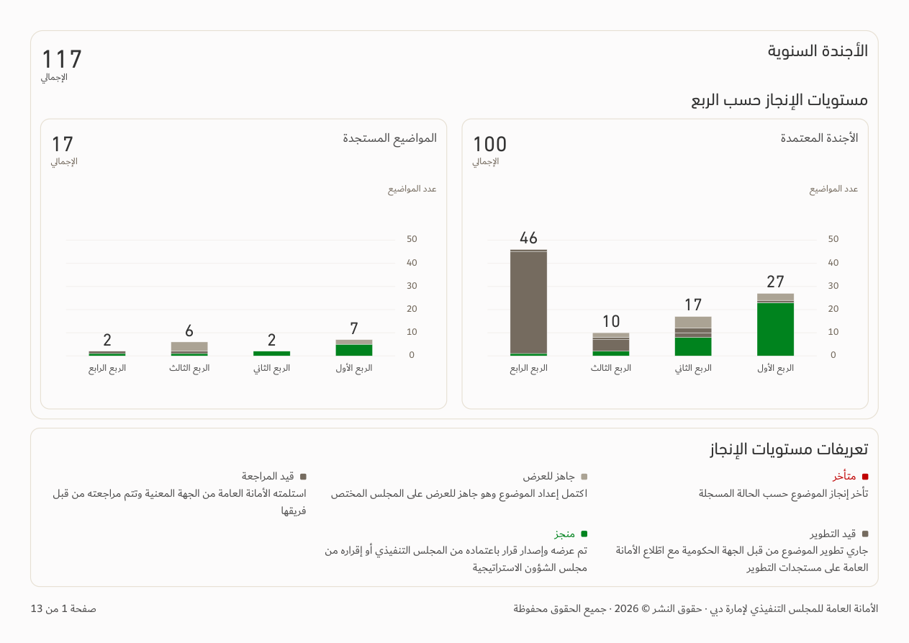
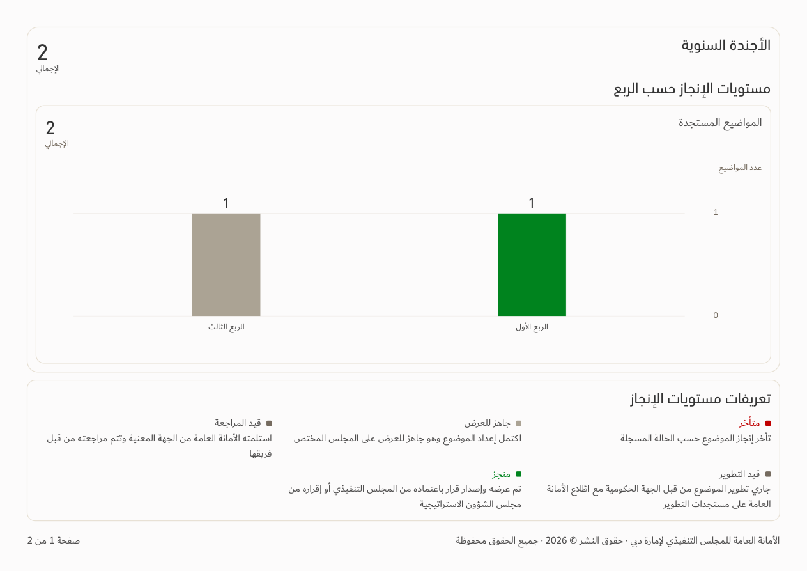
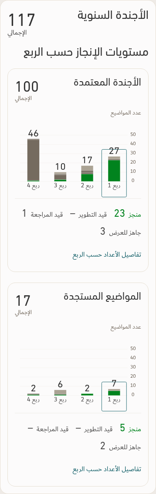

# Approved agenda quarter charts — v153

[Download app](../Performance-App-v153.zip) · [Verification](../Saytara-Verification-v153.md) · [Design contract](AGENDA-DESIGN-v153.md)

The approved chart is applied to the agenda page and native A4 landscape PDF. Quarter columns use counts on one shared axis, divided by status. Percentages and quarter-ratio summaries are omitted. The original definitions remain below the charts.

The images use an illustrative workbook. Actual app charts follow the selected report scope.

