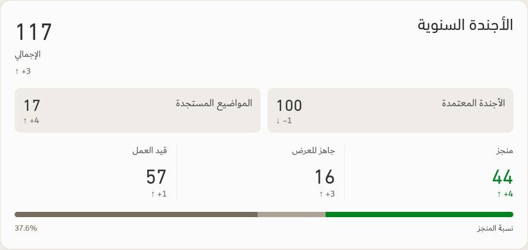

# Annual agenda — completion caption concept

Preview only. The application and PDF export remain unchanged.

The approved two-box layout is retained. Beneath the existing three-segment status bar, the proposed caption shows **نسبة المنجز** on the right and **37.6%** on the left, matching the special-projects caption.

Calculation: 44 completed / 117 total annual-agenda items × 100 = 37.6%. Total includes 100 approved agenda items and 17 emerging topics. The bar retains 44 completed, 16 ready to present, and 57 in progress. All values reproduce the user's screenshot; this is an illustration rather than a new operational report.

Caption uses the existing special-projects style: 14px Dubai Regular, Ink #4F4E4E, with 8px separation below the bar. Both agenda-type boxes retain equal width and their 12px gap.

[Before and after](Agenda-Completion-Before-After.png)

Verified the calculation, right-to-left label placement, font, bar proportions, equal box widths, and absence of local overflow. Both rendered images were visually inspected. Mobile and PDF behavior are outside this preview's scope.
