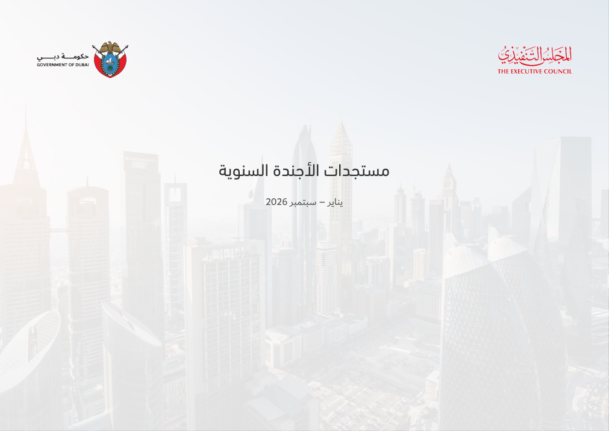
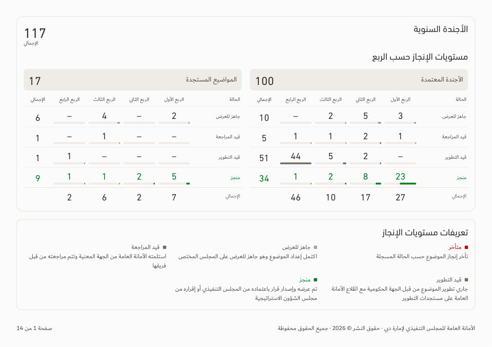
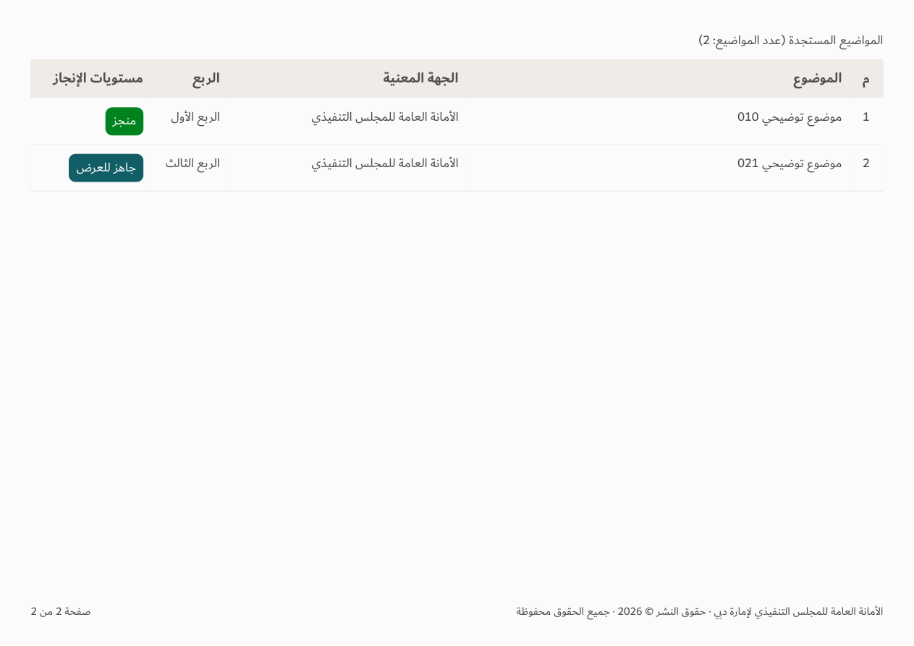

# Agenda corrections — v149

[Download app](../Performance-App-v149.zip) · [Verification](../Saytara-Verification-v149.md) · [Approved rules](AGENDA-DESIGN-v149.md)

Full-page cover without footer; content numbering and copyright begin on the second physical page. Emerging-topic tables include entity names, their title and count. The chart scale-range note is removed.

Screenshots use illustrative data; no source workbook is bundled.
