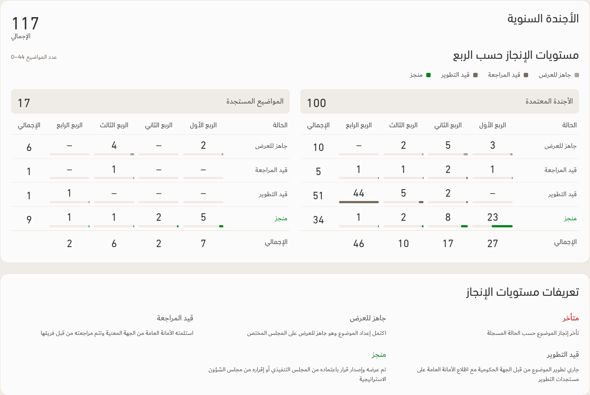
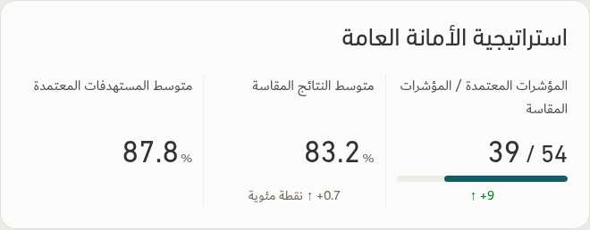

# Agenda definitions and strategy alignment — v147

**تعريفات مستويات الإنجاز** is directly under the chart, before the topic tables. PDF content follows the same order, using the next page when needed to preserve readable type and margins.

[Download updated app](../Performance-App-v147.zip) · [Verification](../Saytara-Verification-v147.md)

[Phone placement](definitions-phone.png)

The strategy caption is **المؤشرات المعتمدة / المؤشرات المقاسة**. Approved is on the right; measured is on the left.

[Native PDF alignment](strategy-native-pdf.png)

Images use illustrative data. No source workbook is bundled.
