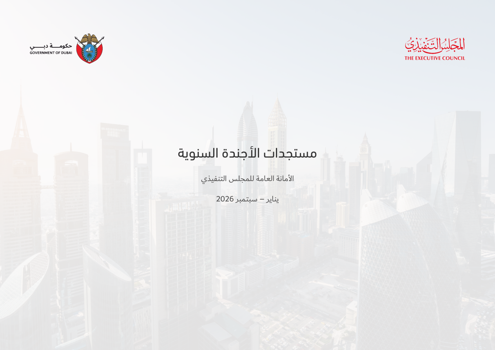
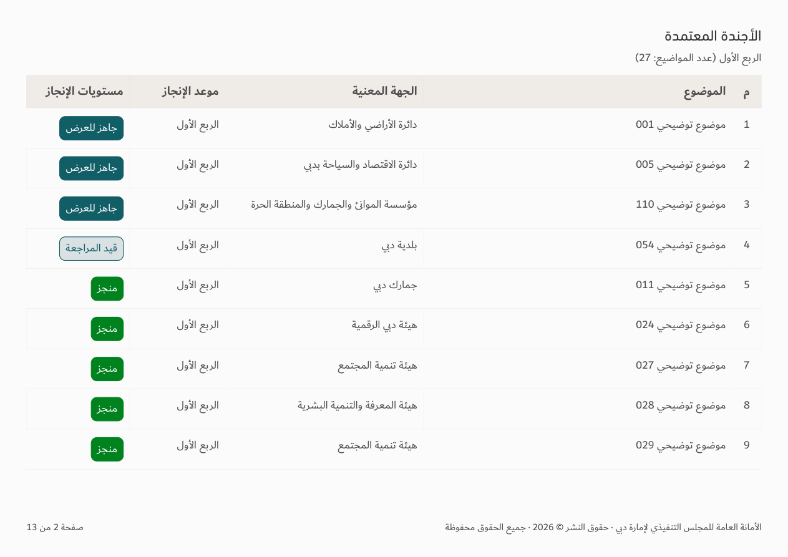
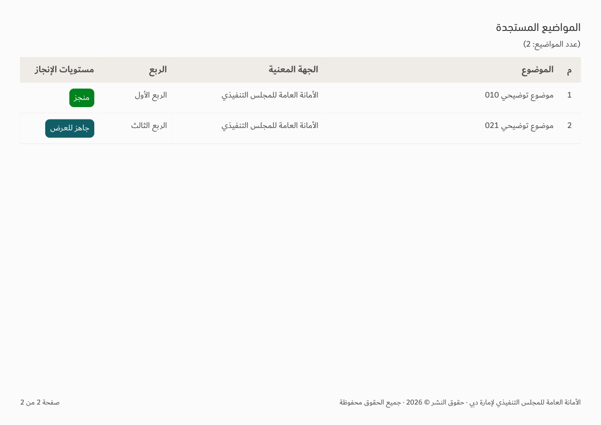

# Agenda layout — v151

[Download app](../Performance-App-v151.zip) · [Verification](../Saytara-Verification-v151.md)

Centered cover text, one-line deadline column heading, consistent cohort titles and hidden empty table sections. Existing chart bars are retained.

Illustrative workbook records shown. The [vertical quarter concept](../Agenda-Quarter-Distribution-Concept/README.md) is review-only.
