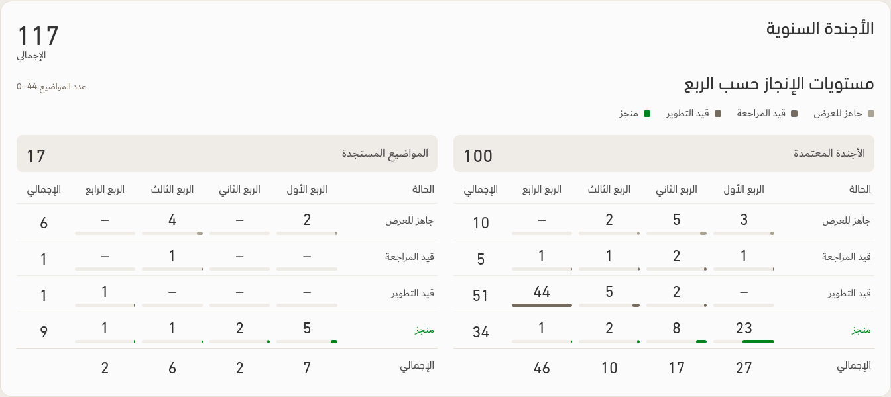
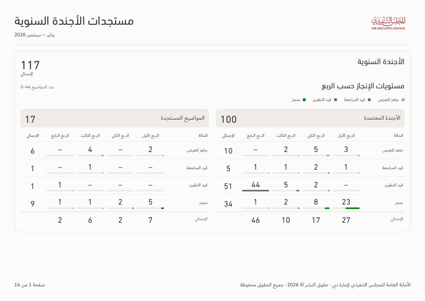

# Approved agenda report — v146

The approved original matrix is implemented. Zero counts display as **–**; only late/completed status names use Red/Green. The shared legend remains. Empty status/quarter categories hide across the selected scope while the cohort matrices retain aligned rows/columns. Percentages and bottom-left duplicate grand totals are removed.

Both charts stay together on the first A4 landscape PDF page. Title, selected entity and month range appear once. Tables have wider topic/entity columns and repeat their headings. The agenda source-notes appendix and links are removed from the page/PDF.

[Download app](../Performance-App-v146.zip) · [Verification and limits](../Saytara-Verification-v146.md) · [Approved agenda rules](AGENDA-DESIGN-v146.md)

35 responsive screen states, seven actual native PDFs and 3,596 assertions pass. True-offline download and a fresh-extraction smoke test pass. Tests use illustrative records; no operational workbook is included. The managed browser blocks cold file-origin launches; Windows launch is not claimed as tested.

[Phone](all-390.png) · [Filtered entity](entity-1440.png) · [Late/undated test case](synthetic-1440.png)

[Filtered first page](entity-page-01.png) · [Continuation table page](entity-page-02.png) · [Illustrative all-scope PDF](all.pdf) · [Illustrative entity PDF](entity.pdf)
