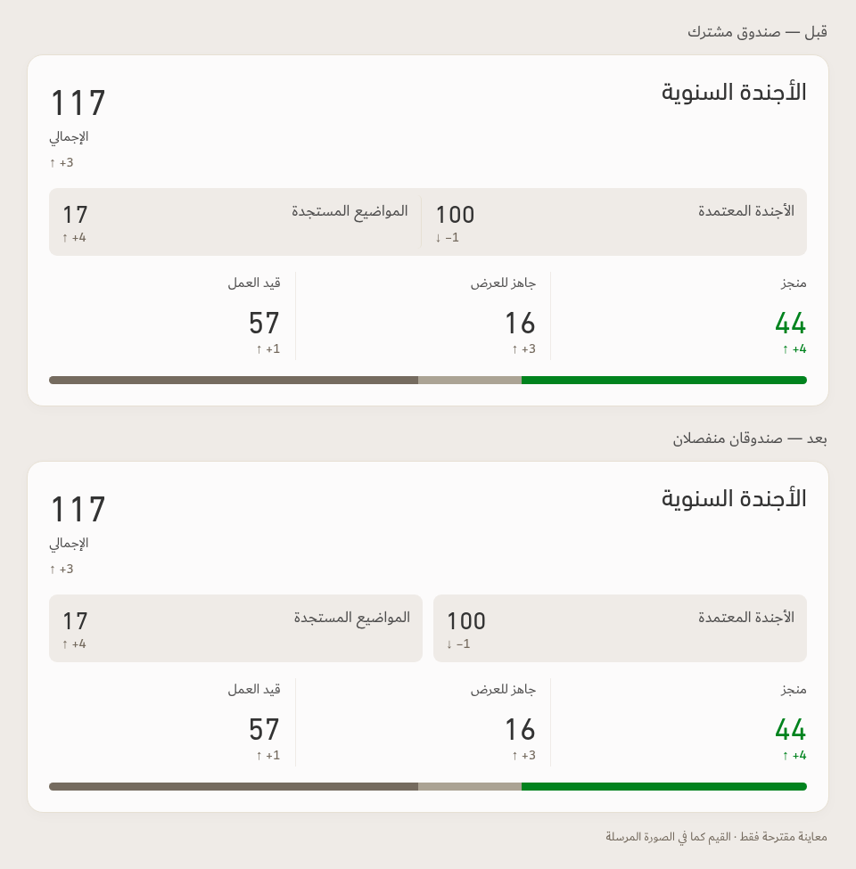

# Annual agenda — two-box concept

Preview only, 13 October 2026. No application or PDF layout changes applied.

The approved agenda (100, down1) remains on the right; emerging topics (17, up4) remain on the left. Each has its own Linen background, equal width and 9px rounded corners, separated by 12px. Existing 18px Dubai Regular labels and 28px DIN Next LT Arabic figures retain their alignment. Total117 and status values44/16/57 are reproduced from the user's screenshot for both before and after. The comparison is a visual reconstruction using v143's actual component and fonts, not a newly calculated report.

[Proposed card at full size](Agenda-Two-Boxes-After.png)

Verified equal box dimensions, physical RTL order, font families/sizes, 12px gap and no local overflow. The rendered composition was visually inspected. Live mobile behavior and PDF implementation are outside this concept's scope.
