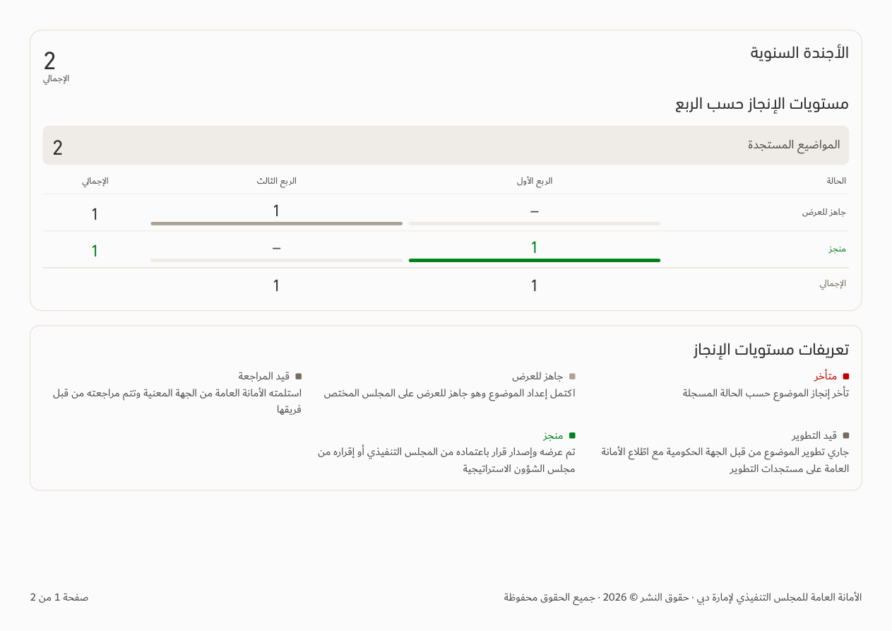
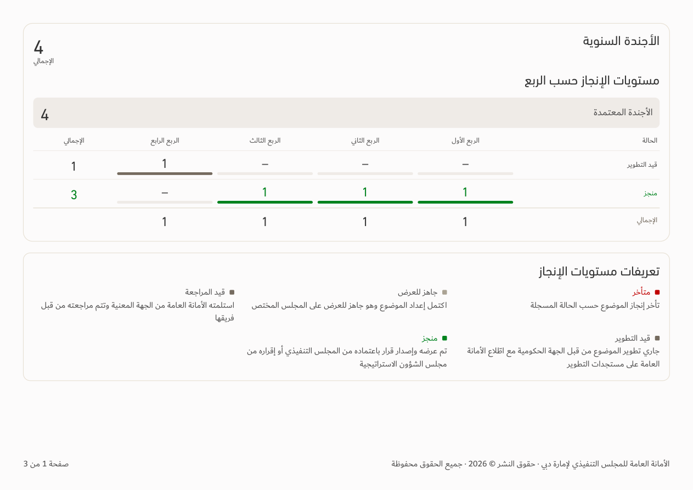

# Agenda category visibility — v150

[Download app](../Performance-App-v150.zip) · [Verification](../Saytara-Verification-v150.md)

Empty chart categories are hidden; a populated category uses the available width. Full-empty scopes retain their empty-state message. Source counts and zero dashes within populated categories are unchanged.

[Phone chart](emerging-only-chart-390.png). Illustrative data only. Includes all [v149 agenda corrections](../Agenda-Corrections-v149/README.md).
