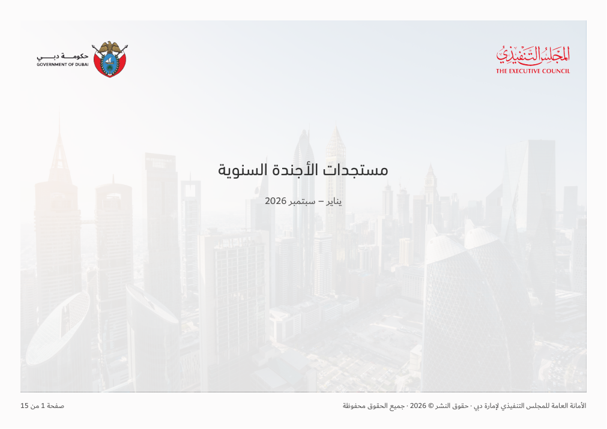
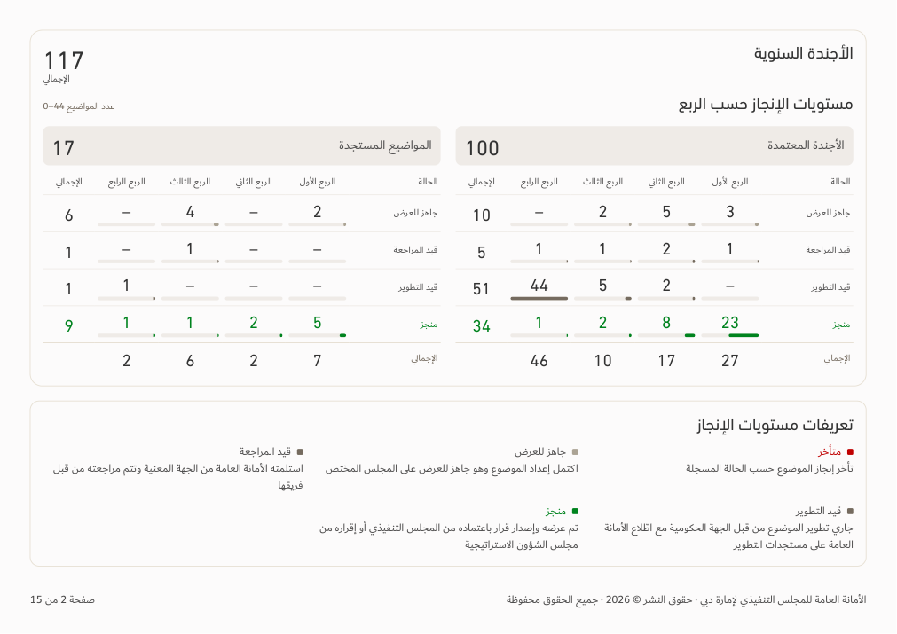
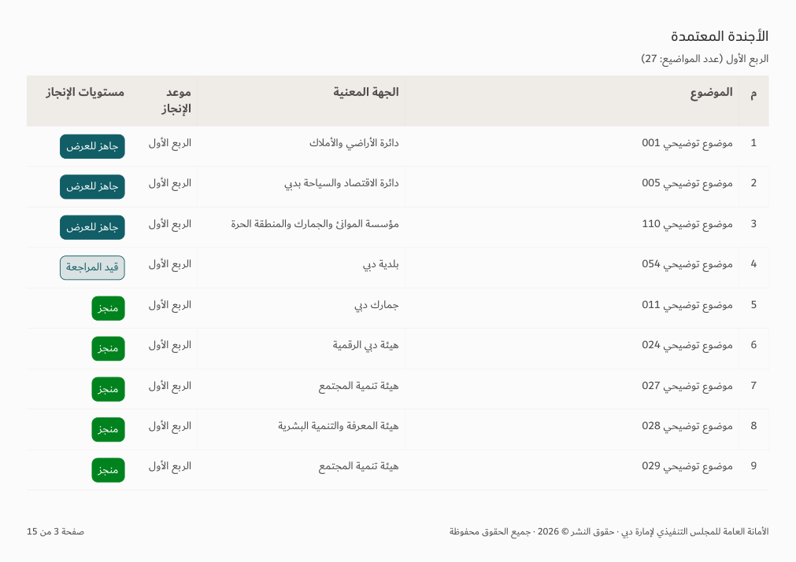

# Agenda and navigation — v148

[Download app](../Performance-App-v148.zip) · [Verification](../Saytara-Verification-v148.md) · [Approved rules](AGENDA-DESIGN-v148.md)

Agenda cover restored; both charts and the lower definitions legend share page 2. Table headings include cohort, quarter and topic count. Completed/late chart values use their status colors. Search menu is on the right, and navigation follows the requested sequence throughout the app.

[Selected-entity cover](entity-1.png). Screenshots use illustrative data; no source workbook is bundled.
