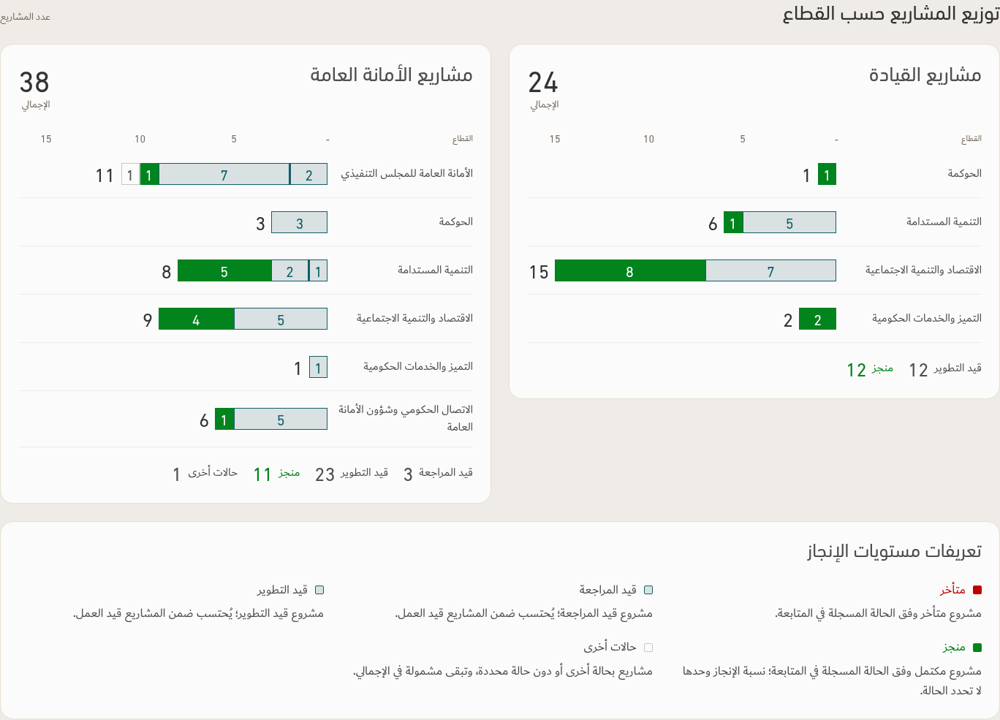
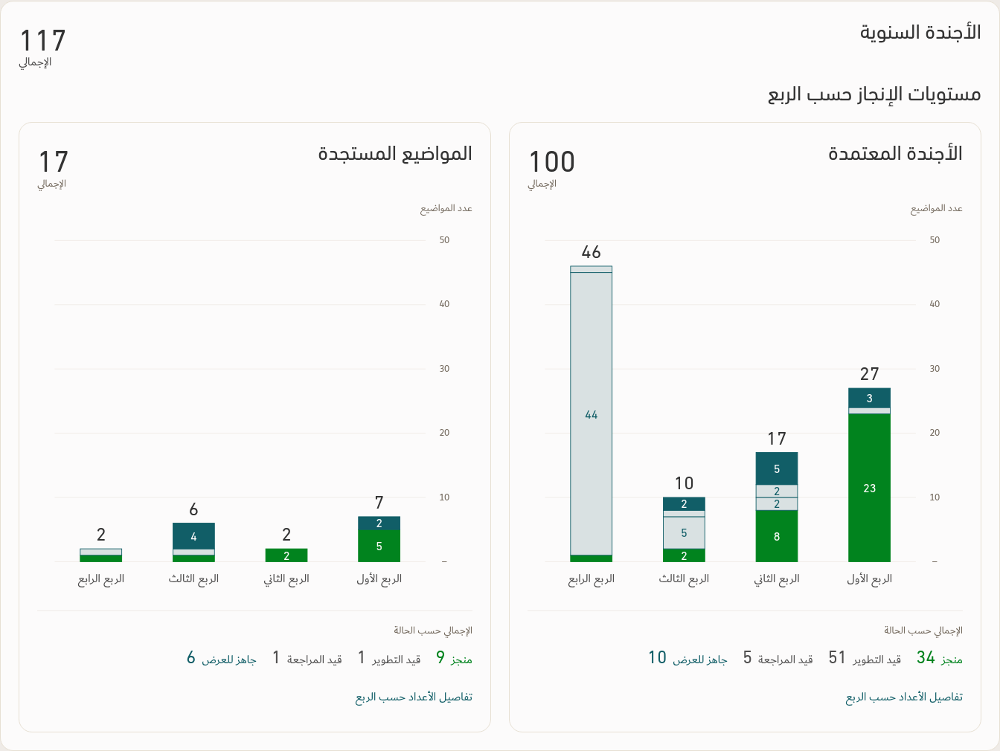
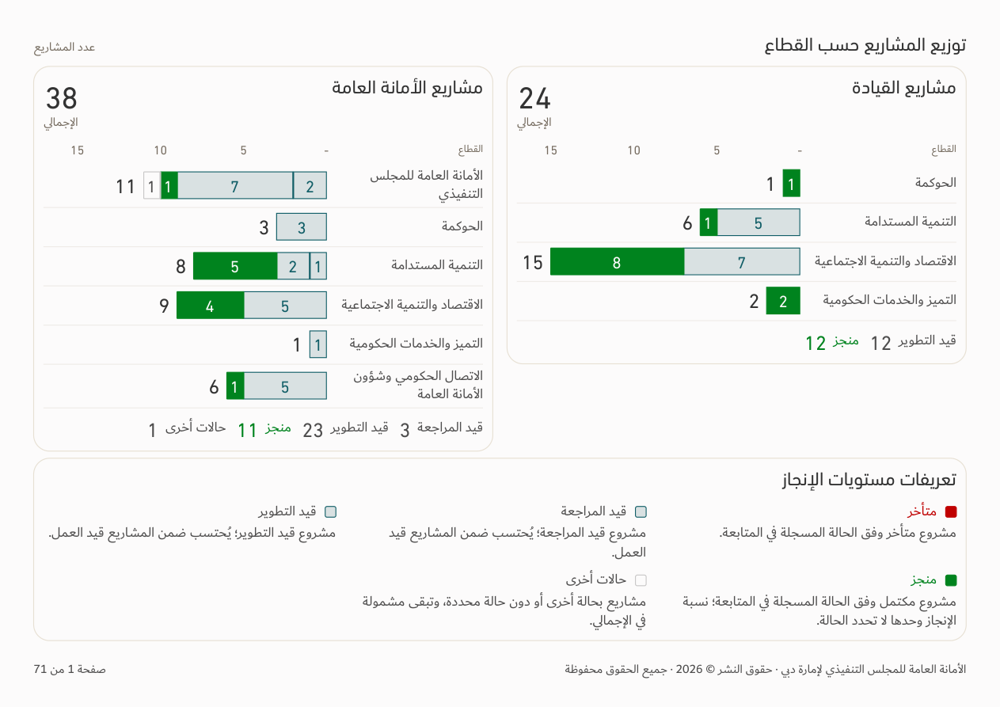
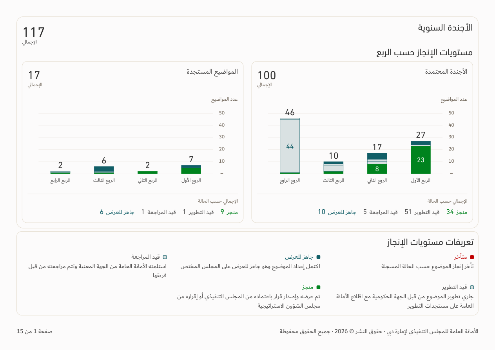

# Applied charts and shared display rules — v155

[Download app](../Performance-App-v155.zip) · [Updated TEC skill and principles](../TEC-Apple-Inspired-Skill-and-Principles.zip) · [Revision 22](../Design-Standard/TEC-Apple-Inspired-Design-Standard-Revision-22.md) · [Verification](../Saytara-Verification-v155.md)

HH reports use the approved leadership/TEC charts, with blank leadership classifications included in TEC. Empty sector rows and empty cohorts hide; counts remain inside proportional bars where legible, with totals immediately beyond each endpoint. Aggregate status totals and the detailed legend remain.

Agenda adds readable in-bar counts while retaining exact quarter values, original definitions and aggregate totals by default. Native PDFs place charts and definitions together after the cover and include the exact agenda count matrix afterward.

Across the app, numeric zero metrics display a dash, generated missing-value placeholders are blank, and plain ready-status labels and counts use Teal. Filled Teal badges and bars retain light text for contrast. Source records, identifiers, dates, raw exports and calculations retain their values.

These previews use the existing illustrative workbook dated 30 September 2026. Application data follows the user's selected workbook and filters.

See the verification report for actual checks and remaining limitations. PowerPoint native structure/data were checked; Office rendering and in-application editing were unavailable.
