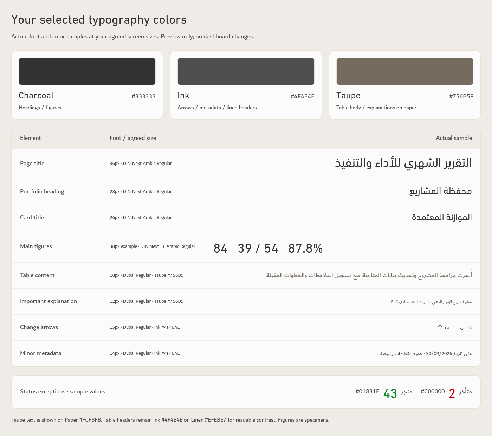
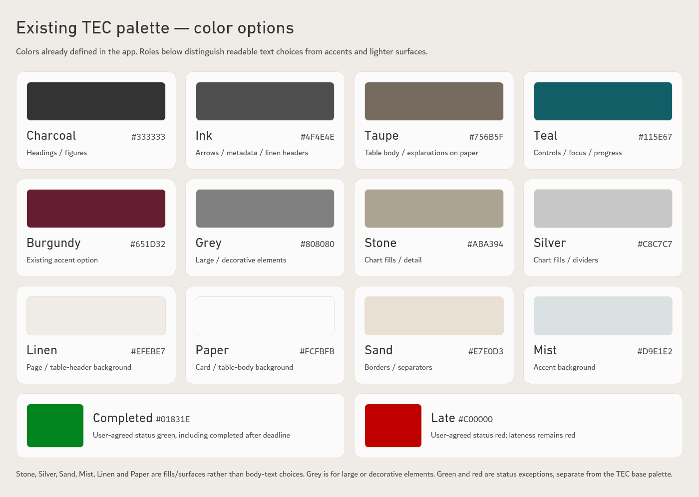

# TEC typography colors and palette options

Preview of the latest agreed typography/color specification. Actual bundled DIN Next Arabic Regular, DIN Next LT Arabic Regular and Dubai Regular were loaded for these samples. Sample text and figures are illustrative; app styles and source data are unchanged.

## Selected text colors

| Element | Agreed size | Font | Default text color |
| --- | --- | --- | --- |
| Page title | 36px | DIN Next Arabic Regular | Charcoal #333333 |
| Portfolio headings | 28px | DIN Next Arabic Regular | Charcoal #333333 |
| Card titles | 26px | DIN Next Arabic Regular | Charcoal #333333 |
| Main figures | 34–40px | DIN Next LT Arabic Regular | Charcoal #333333, with source-status exceptions |
| Table body, names and notes | 18px | Dubai Regular | Taupe #756B5F |
| Important labels and explanations | 12px | Dubai Regular | Taupe #756B5F |
| Change arrows and differences | 15px | Dubai Regular | Ink #4F4E4E, with performance exceptions |
| Minor metadata | 14px | Dubai Regular | Ink #4F4E4E |

## Updated formatting rules

- Use DIN Next Arabic Regular for headings, DIN Next LT Arabic Regular for main figures, and Dubai Regular for supporting text.
- Table names and notes use Taupe #756B5F and regular weight. Status labels carry the agreed status colors.
- Important labels and explanations use Taupe #756B5F; change arrows and minor metadata use Ink #4F4E4E.
- Keep taupe text on warm-white Paper #FCFBFB. Table headers remain Ink #4F4E4E on Linen #EFEBE7 for readable contrast.
- Arabic table text uses approximately 1.6 line spacing, natural wrapping and comfortable row padding.
- Change arrows sit below their values on aligned baselines. Performance color follows the meaning of the change rather than arrow direction alone.
- Mobile layouts reflow while preserving readable text sizes.
- Print uses a separate readable scale; pagination accommodates the content.

Establish this on the monthly page first, reviewing the header, cards and table at 100% browser zoom, then reuse the approved typography standard on the other pages.

## Existing TEC palette options

The sheet shows the 12 exact palette tokens already in the app. Charcoal, Ink and Taupe are the selected text roles. Teal and Burgundy are existing accents. The lighter tones serve surfaces, dividers and chart fills. Grey is suitable for large or decorative elements rather than small regular text. User-agreed completed green #01831E and late red #C00000 remain separate status exceptions.

Taupe on Paper has 5.05:1 numerical contrast; Taupe on Linen is 4.40:1, so Ink remains the table-header color on Linen (6.99:1). This numerical check is not an accessibility certification.

Open either image to view or download the full-resolution specimen.
