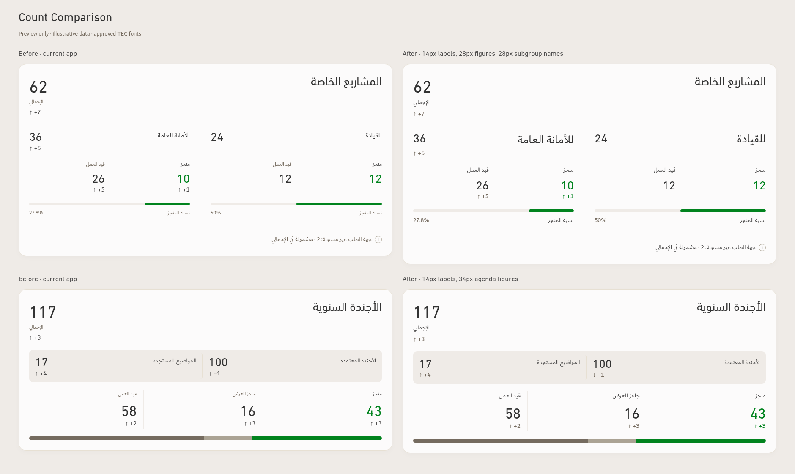
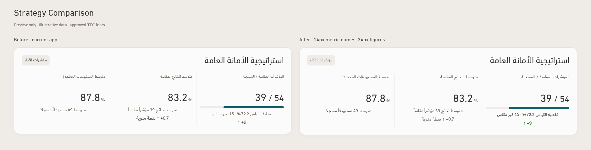
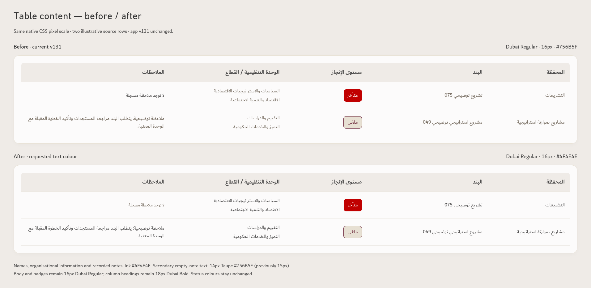

# Monthly cards — revised compact hierarchy

**Preview only. The app and v131 release are unchanged.** Financial bars are approved; this package revises the typography/layout concept with the latest sizes and colors.

[Download the complete revised preview](https://github.com/ormbh/Performance-App-2/raw/refs/heads/main/TEC-Compact-Typography-Concept.zip)

The original compact grouping is restored: short labels above their figures, two status columns within each special-project subgroup, and three agenda columns. Labels use 14px instead of the rejected 34px treatment. Special-project figures stay 28px; agenda/strategy figures stay 34px. Subgroup names become 28px Dubai. Values and their change arrows share aligned rows; each subgroup's completion bar stays on a shared baseline.

| Element | Current screen | Revised screen | Font | Default color |
| --- | --- | --- | --- | --- |
| Page title | 38px | 38px retained | DIN Next Arabic Regular | Charcoal #333333 |
| Portfolio headings | 30px | 30px retained | DIN Next Arabic Regular | Charcoal #333333 |
| Card titles | 28px | 28px retained | DIN Next Arabic Regular | Charcoal #333333 |
| Main totals | 40px | 40px retained | DIN Next LT Arabic Regular | Charcoal #333333 |
| Special-project totals, 24 / 36 | 28px | 28px retained | DIN Next LT Arabic Regular | Charcoal #333333 |
| Agenda status figures | 34px | 34px retained | DIN Next LT Arabic Regular | Charcoal #333333; status exceptions |
| Special-project status figures | 28px | 28px retained | DIN Next LT Arabic Regular | Charcoal #333333; status exceptions |
| Subgroup names | 16px | **28px** | Dubai Regular | Charcoal #333333 |
| Short value/status labels | 12px | **14px** | Dubai Regular | **Ink #4F4E4E** |
| Strategy metric names | 12px | **14px**, above values | Dubai Regular | **Ink #4F4E4E** |
| Strategy primary figures | 34px | 34px retained | DIN Next LT Arabic Regular | Charcoal #333333 |
| Strategy registered denominator, 54 | 28px | 28px retained | DIN Next LT Arabic Regular | Charcoal #333333 |
| Table content, names and recorded notes | 16px | 16px retained | Dubai Regular | **Ink #4F4E4E** |
| Table column headings | 18px | 18px retained | Dubai Bold | Ink #4F4E4E |
| Status badge text | 16px | 16px retained | Dubai Regular | Existing approved status palette |
| Important labels and explanations | 14px | 14px retained | Dubai Regular | **Ink #4F4E4E** |
| Change arrows and differences | 15px | 15px retained | Dubai Regular | **Taupe #756B5F**, with performance exceptions |
| Minor metadata | 14px | 14px | Dubai Regular | **Taupe #756B5F** |

The empty-note placeholder in the table is secondary metadata: it uses 14px Taupe. Actual recorded notes remain 16px Ink. No new bold table names or new status colors are introduced.

## Cards — before and after

## Strategy — before and after

Strategy metric names continue to identify three different measures. RTL placement stays measured/registered at right, average results in the middle, average targets at left. The figure row remains aligned.

## Table text — before and after

[Full table preview](table/index.html) · [Table rules and evidence](table/README.md).

## Approved financial bars

The agreed solid style is retained: allocation/budget **Taupe #756B5F**, spending **Teal #115E67**, unused track **Linen #EFEBE7**. Financial hatching and availability notes are removed in the concept. Figures, bar lengths and calculations are unchanged. This approval does not override the instruction to keep the app unchanged until implementation is requested.

[Financial bar comparison](bars/financial-bars-before-after.png).

## Revised rules

- Keep labels close to their values, above the numeric row. Avoid the oversized labels and widely separated pairs from the rejected concept.
- Use 28px Dubai subgroup names, 28px special-project figures, 34px agenda/strategy figures and 14px Dubai short labels.
- Use Ink #4F4E4E for table body, names, notes and essential explanations. Keep table names regular; column headings remain Dubai Bold.
- Use Taupe #756B5F for secondary metadata and neutral changes. Preserve the existing meaningful performance colors for favorable/adverse changes.
- Keep each change arrow beneath its own figure. Shared tracks align subgroup values and completion bars when a change is absent in one group.
- Keep the strategy metric names above the values; retain all three measures and their definitions.
- Mobile reflows subgroup blocks and strategy metrics without shrinking the approved text sizes. Arabic table text keeps 1.6 line spacing and natural wrapping.
- Retain the previously approved Search, Navigation and Print concepts. The last approved print table scale remains 12pt Dubai Regular with 13.5pt Dubai Bold column headings; screen font increases do not silently enlarge print.

## Verification and viewing

Native Chromium 151, device scale 1 / 100% zoom. The latest typography, exact colors, unchanged figures, shared value/bar rows and 1880/1440/390px layouts passed. Fonts are the original approved app assets; no substitutes. Before/after table cells and badges keep identical geometry and status colors. A visual review found no overlaps or missing values.

All app source and release bytes match v131. The examples use clearly labelled illustrative QA data; no operational workbook or uploaded report is included. The financial specimen's 44 and 72% are style examples, not a reconciled operational amount.

[Revised cards together](comparisons/revised-cards.png) · [Mobile special projects](comparisons/mobile-special-390.png) · [Mobile agenda](comparisons/mobile-agenda-390.png) · [Mobile strategy](comparisons/mobile-strategy-390.png) · [Render evidence](render-evidence.json).

Extract the ZIP and open index.html, or view the included PNGs at full size. These are screen previews; no new print export or accessibility certification is claimed.
