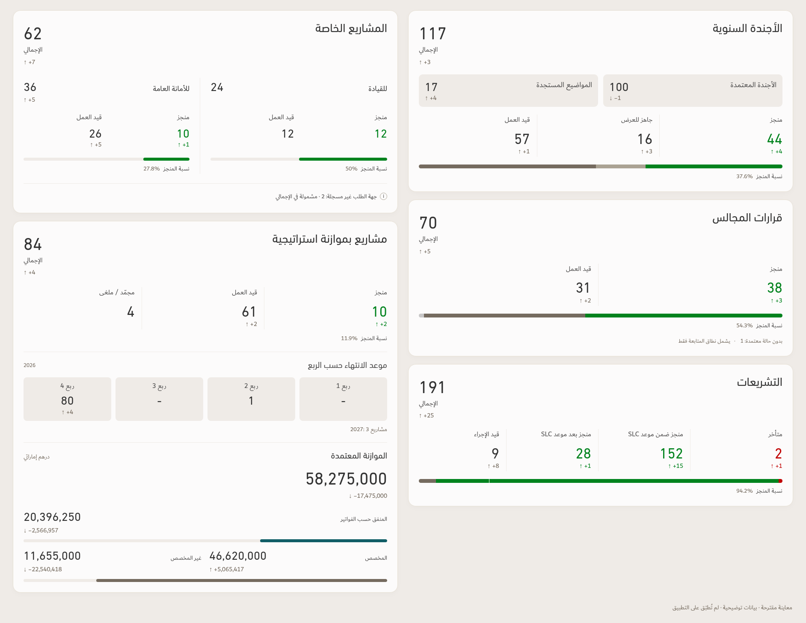

# Completion captions — consolidated preview

Illustration only. No app source, application ZIP, or PDF export was changed.

- Annual agenda: separate, equal boxes for approved agenda and emerging topics, with a 12px gap.
- Annual agenda, council decisions and legislation: **نسبة المنجز** with the percentage directly beside it beneath the existing segmented bar.
- Special projects: the same adjacent caption beneath both existing subgroup completion bars.
- Budgeted projects: only **نسبة المنجز 11.9%** beneath the status figures, before the quarterly section. No completion bar was added. Both financial bars are unchanged.

Captions use 14px Dubai Regular, Ink #4F4E4E, and an 8px label/value gap on a common baseline. Arabic stays on the right; the LTR-isolated percentage follows beside it.

| Card | Completed | Total | Percentage |
| --- | ---: | ---: | ---: |
| Annual agenda | 44 | 117 | 37.6% |
| Council decisions | 38 | 70 | 54.3% |
| Legislation | 152 + 28 | 191 | 94.2% |
| Special projects — leadership | 12 | 24 | 50% |
| Special projects — General Secretariat | 10 | 36 | 27.8% |
| Budgeted projects | 10 | 84 | 11.9% |

Agenda figures reproduce the latest user screenshot. The other cards use the frozen illustrative preview workbook. These are design specimens, not a reconciled operational snapshot. Council's denominator includes one decision without an approved status; legislation includes both completed SLC cohorts. The budgeted-project denominator includes all 84 projects, including statuses not shown among the three headline figures.

[Special projects](Special-Projects-Captions-Preview.png) · [Budgeted projects](Budgeted-Projects-Captions-Preview.png)

QA: formulas, all six caption positions and 8px gaps, common text baseline, fonts/colors, equal agenda boxes and 12px gap, absence of local overflow, no budget completion bar and two preserved financial bars passed. The full composition and budgeted-project card were visually inspected. This static preview does not establish mobile or PDF behavior.
