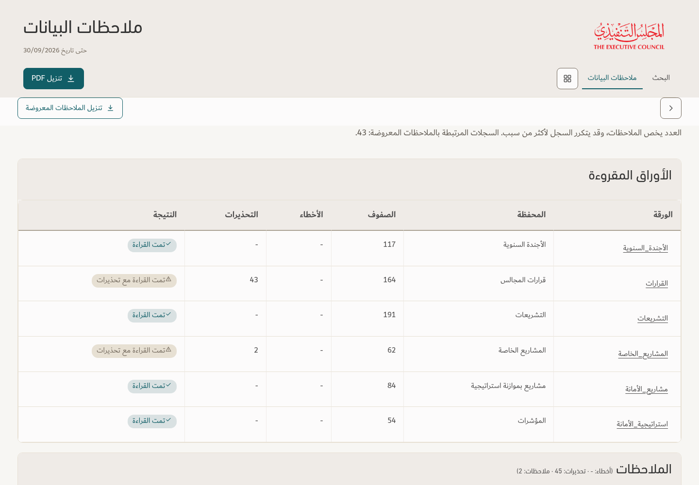

# Actionable data observations — v159

[Download app](../Performance-App-v159.zip) · [Policy](DATA-CHECKS-POLICY.md) · [Verification](../Saytara-Verification-v159.md)

Sector/department mismatches and controlled values outside approved lists are flagged. Valid Active/zero projects, shared titles, blank leadership flags and future completion dates no longer inflate the list. Finance values require review; missing follow-up requirements are conditional on follow-up evidence. Source records and reporting metrics are preserved.

Screenshots and tests use the existing illustrative workbook. The user's uploaded production CSV is not included in this release.

