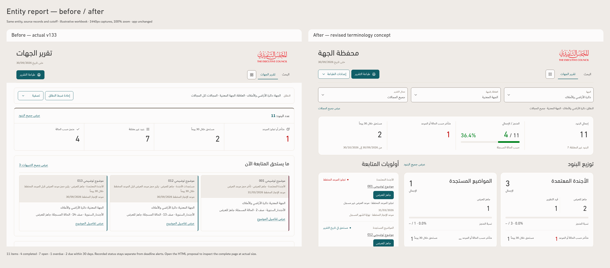
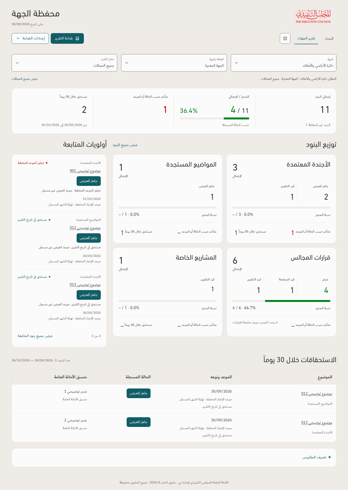

# TEC entity report — revised terminology concept

Separate entity-report design study, revised with source-safe Arabic terminology and the approved TEC visual tokens. Performance App v133 and its approved standard remain unchanged.

Both views use identical records from the frozen illustrative workbook and the same scope and cutoff, 30/09/2026. These are illustrative records, not an operational assessment of the named entity.

[Open the before / after image](TEC-Entity-Report-Before-After.png) · [Open the full proposed page](TEC-Entity-Report-Proposal.png)

[Download the interactive concept and tables](TEC-Entity-Report-Concept.zip) · [Read the specification](TEC-Entity-Report-Study.md) · [Terminology before / after and sizes](Terminology-Review.md)

The ZIP contains the standalone preview, source-safe information tables, fonts and logo, desktop and mobile images, and focused verification. Navigation and printing illustrate placement; application navigation and export are not implemented in this concept.

No operational workbook or supplied operational PDF is included. Strategic-budget projects need a validated entity relationship before inclusion.
