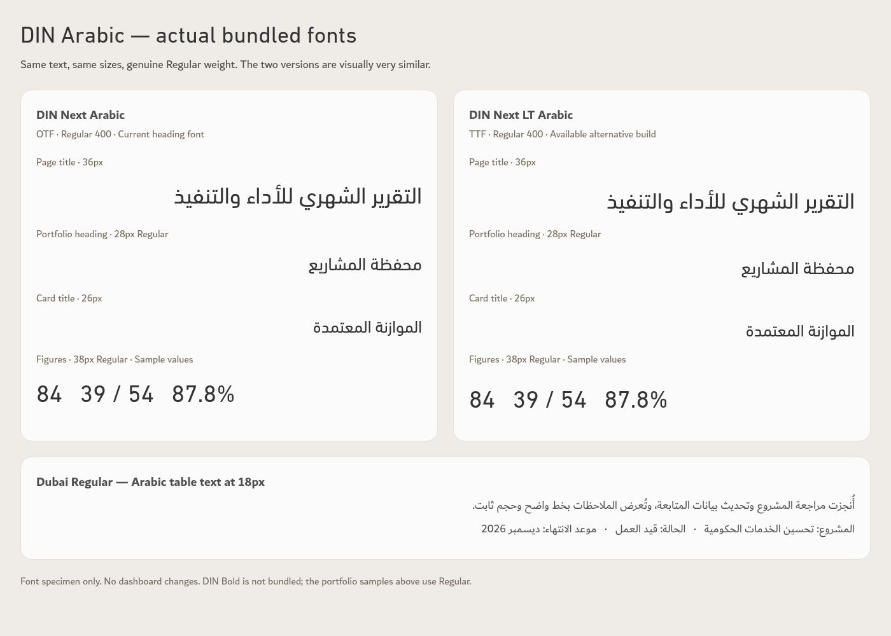
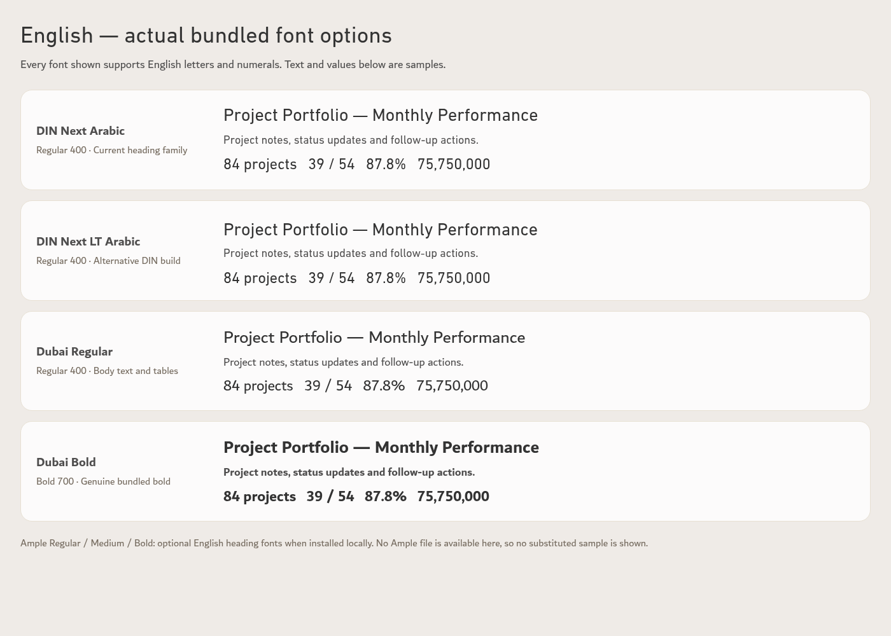

# TEC font comparisons

Actual browser-rendered samples using the fonts bundled with Performance App v128. These previews do not change the app or its agreed typography specification. All text and figures are specimens.

## Arabic DIN comparison

Both DIN Next Arabic and DIN Next LT Arabic are genuine Regular 400 fonts. They are closely related versions of the same design, with small rendering differences. The 28px portfolio samples use Regular because no DIN Bold file is bundled.

## English options

Both DIN versions support English and numerals. Dubai Regular and Dubai Bold are also bundled. Ample Regular, Medium and Bold are configured as optional installed English heading fonts; no genuine Ample file is available in this workspace, so no fallback is presented as an Ample sample.

Open an image to view or download it at full resolution. Specimens were rendered at 1400px wide, device scale 1, with all four bundled font faces loaded and font synthesis disabled.
