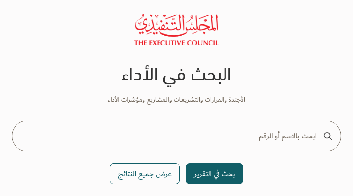
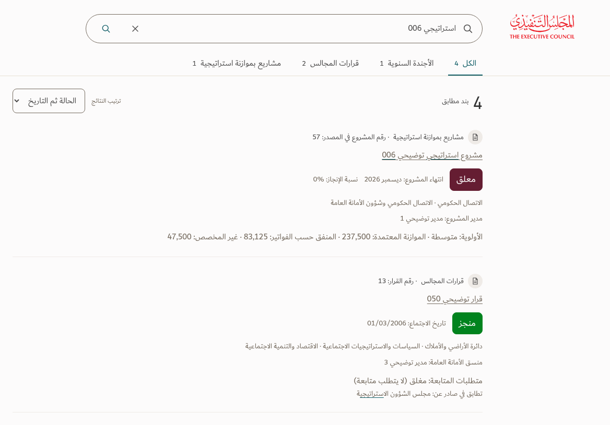

# Google-like TEC search preview

A new search direction requested by the user: Google's simple composition with the approved TEC logo, fonts, colors and status meaning. **Preview only; the working v128 app remains unchanged.** The upload proposal is unchanged.

## Views

[Full desktop home](TEC-Google-Search-Home.png) · [Full desktop results](TEC-Google-Search-Results.png) · [No matches](TEC-Google-Search-No-Match.png) · [Mobile home](TEC-Google-Search-Home-Mobile.png) · [Mobile results](TEC-Google-Search-Results-Mobile.png)

The home page centers the TEC logo, page title, rounded search field and two actions on Paper. Results use a compact persistent search bar, populated portfolio categories and a clean RTL list. There is no enclosing search card. The search pill and slim category tabs are deliberate exceptions to the usual 8px field geometry and filled tabs, following the user's Google-like direction.

| Element | Preview treatment |
| --- | --- |
| Page title | DIN Next Arabic Regular, 38px, Charcoal |
| Search input and action buttons | Dubai Regular, 16px; minimum 44px input/targets |
| Result names and source context | Dubai Regular, 16px, neutral Taupe; names remain regular |
| Status badges | Dubai Regular, 18px; approved distinct colors |
| Supporting text and metadata | Dubai Regular, 14px; approved Ink/Taupe roles |
| Main count | DIN Next LT Arabic Regular, 34px |
| Surfaces | Paper page, Linen footer, restrained Sand dividers |

Desktop captures use a 1920px viewport at 100% CSS scale and device scale factor 1. Focus crops preserve actual pixel scale. Mobile captures use 390px; long category labels scroll within their row while the page fits the viewport.

## Try the prototype

Download and extract [TEC-Google-Search-Preview.zip](TEC-Google-Search-Preview.zip), then open **TEC-Google-Search-Preview.html**. It contains the actual bundled TEC fonts and logo, illustrative records, and the original v128 search engine. No server or installation is required.

- Submit with Enter or the search button. Try **استراتيجي 006** to reproduce the four-record screenshot.
- Clear returns to the empty home page; **عرض جميع النتائج** explicitly browses all 672 illustrative records.
- Portfolio categories, sorting, pagination and result details work.
- The apps menu and details panel close on outside click or Escape. Escape restores focus.
- Navigation to monthly/projects/upload is disabled in this isolated search prototype; it does not link to unrelated destinations.

This uses **ILLUSTRATIVE-monthly-preview.xlsx**, not live reporting data. The four matching source keys, titles, statuses and percentages match the actual app. Source dates and wording remain literal. A meaningful 0% completion remains visible; a zero no-match count displays **–**. Empty category counts are hidden. Completed legislation stays green, including completion after its deadline; unfinished late work stays red. Legislation's source timing labels remain visible, and KPI contacts use **ملاك الهدف**.

Browser verification covers Arabic/English input direction, source query results, browse count, category filtering, pagination, details/focus, menu closing, supplied font loading and desktop/mobile overflow. [Evidence](evidence.json) records unchanged working-app hashes. This is a targeted design and interaction review, not accessibility certification.

The [approved TEC standard, Revision 2](../Design-Standard/README.md) remains the baseline. Monthly-first implementation and the approved print rule remain unchanged: omit the entity filter, label and selected-value control from print while keeping its selection applied to report content.
