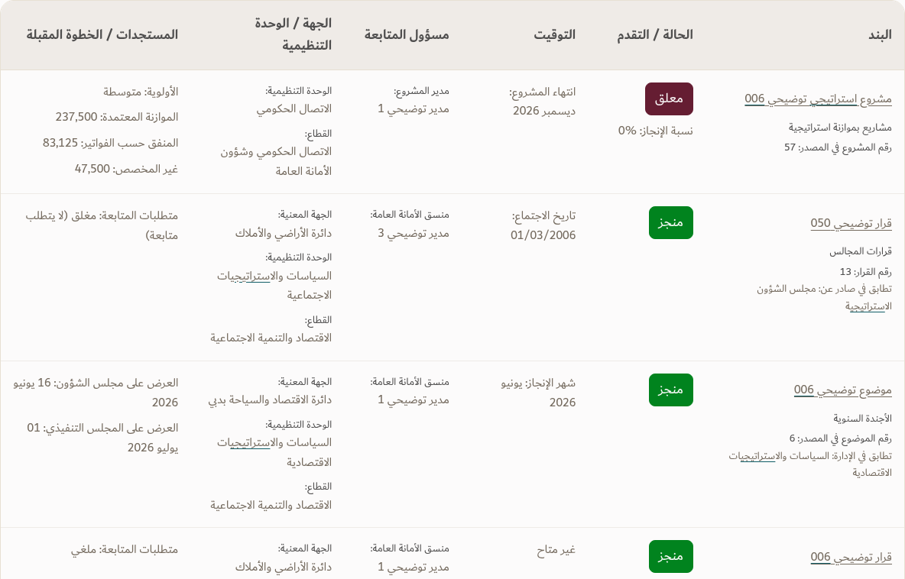

# Approved Google-like search home with table findings

The user approved the upload page and Google-like search page, then requested **search findings in a table**. This preview preserves that approved home and uses the existing search engine and source fields for table results. **The working app remains unchanged.**

[Full desktop results, 1920px](TEC-Google-Search-Table-Results.png) · [Desktop overview, 1280px](TEC-Google-Search-Table-Overview.png) · [Mobile table](TEC-Google-Search-Table-Results-Mobile.png) · [Approved search home](TEC-Google-Search-Table-Home.png)

The previous [list-based results preview](../Google-Search-Previews/TEC-Google-Search-Results.png) is retained for comparison. The [approved upload page](../Search-Upload-Previews/TEC-Upload-After.png) is unchanged.

## Results table

| RTL column | Source content |
| --- | --- |
| البند | Actual item name, portfolio, source reference and matched-field explanation |
| الحالة / التقدم | Source status, timing health and recorded completion percentage |
| التوقيت | Existing portfolio-specific timing fields |
| مسؤول المتابعة | Project manager, coordinator or KPI goal owner, as applicable |
| الجهة / الوحدة التنظيمية | Source entity, organizational unit and sector |
| المستجدات / الخطوة المقبلة | Existing source notes, updates, next steps or project financial context |

Table headings use the supplied **Dubai Bold, 18px, Ink on Linen**. Names, notes and primary table values use **Dubai Regular, 16px, neutral Taupe on Paper**, with natural wrapping, 1.6 line spacing and 16px cell padding. Names keep their neutral color and regular weight when opening details; informational badges retain the approved status colors.

The desktop table uses the available width with approved gutters. Mobile keeps the table readable within a labeled, keyboard-focusable horizontal scroll region; the overall page stays within its viewport. No page-wide text scaling is used.

## Try it

Download and extract [TEC-Google-Search-Table-Preview.zip](TEC-Google-Search-Table-Preview.zip), then open **TEC-Google-Search-Table-Preview.html**. The HTML embeds the fonts, logo, illustrative records and existing search modules.

Search for **استراتيجي 006** to reproduce the four findings. Enter/button search, clear, populated portfolio categories, sorting, pagination and details remain available. The apps menu and details panel close with outside click or Escape. Other app pages are disabled within this isolated prototype.

## Verification

- The approved desktop search-home PNG is pixel-identical to the previous version. The upload page and working app were not edited.
- The same four source keys, order, names, statuses and progress values appear in the table. Search results continue to include all matches; the project follow-up-only rule does not apply to this search table.
- Semantic column and row headers, a table caption, 18px real Dubai Bold headings, 16px regular neutral names and natural wrapping were checked in Chromium.
- Meaningful 0% completion remains visible. A zero no-match count displays **–**; missing values display **غير متاح** rather than an invented zero. Empty portfolio categories remain hidden.
- Closed and completed-after-deadline legislation remain green. Unfinished late work remains red. Source timing labels and KPI contact terminology are preserved.
- Source query/count/category results, pagination, sorting, details, focus return, menu closing and mobile table keyboard scrolling were checked. No overall horizontal overflow was found at 1920px, 1280px or 390px.
- The workbook is **ILLUSTRATIVE-monthly-preview.xlsx**, not live reporting data. Source dates and wording remain literal.

[Browser evidence](evidence.json) · [Independent review](independent-review.md). This is a targeted design/interaction review, not accessibility certification. The approved [TEC design standard](../Design-Standard/README.md), monthly-first rollout and print rules remain the baseline.
