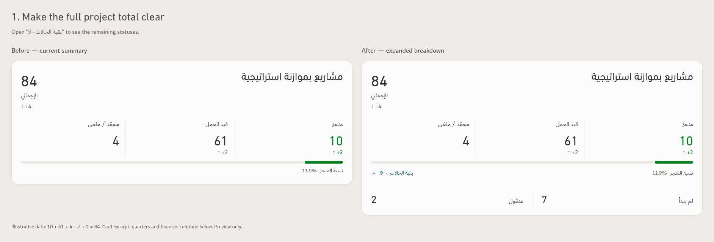
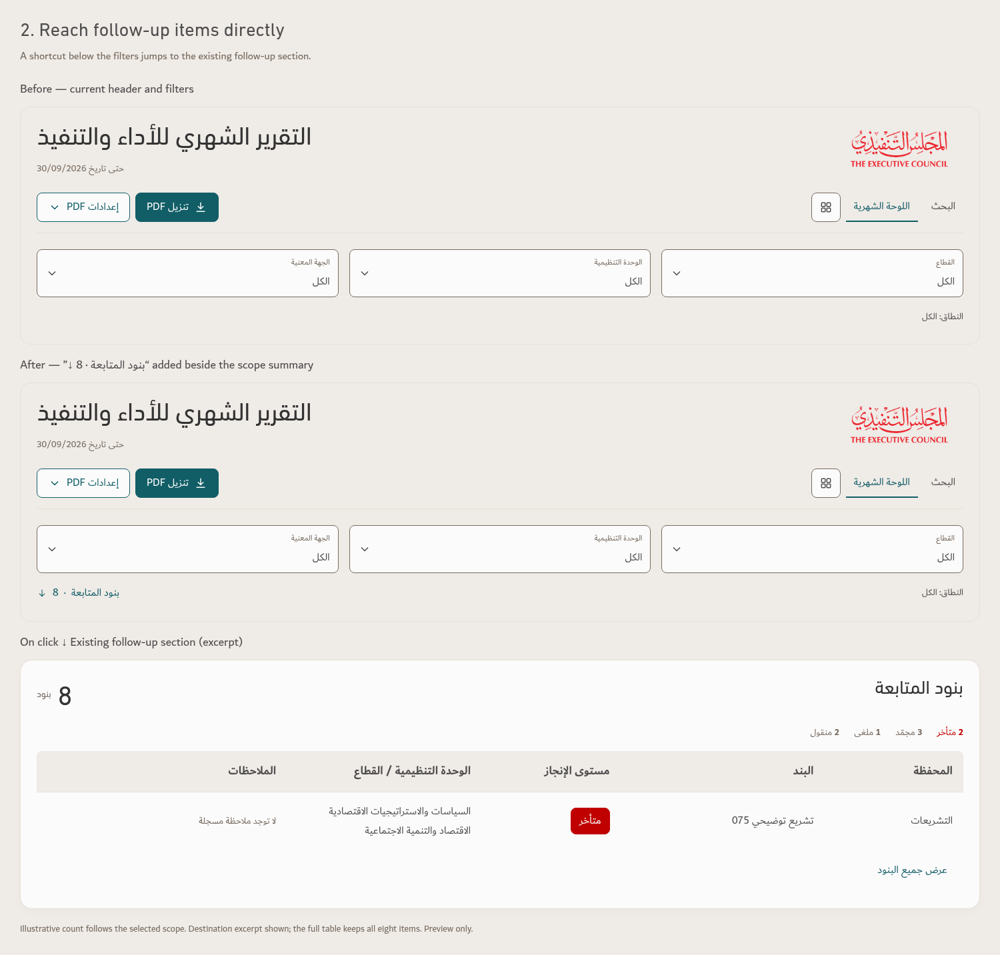

# Monthly dashboard — manager clarity concepts

Preview only. Performance App v144 is unchanged. Uses approved TEC fonts/colors and the actual v144 component markup, with the existing frozen illustrative workbook.

## 1. Reconcile the full budgeted-project total

A compact **بقية الحالات · 9** disclosure sits opposite the completion caption. Expanded, it reveals **لم يبدأ 7** and **منقول 2**, making 10 + 61 + 4 + 7 + 2 = 84. The completion ratio remains 10/84 = 11.9%; status totals, quarters and finances do not change. The images show the status portion of the card; the lower sections continue unchanged.

[Collapsed state](Project-Total-Collapsed.png)

The disclosure illustrates the two nonzero categories in this fixture. A production version should also expose source-defined unknown-status records when present and respect the selected scope. A date-derived late count can overlap other statuses and must not be added again to reconcile the total.

## 2. Jump directly to follow-up items

A **بنود المتابعة · 8 ↓** link appears beneath the filters, opposite the scope summary. It jumps to the existing follow-up heading/table in the same report; it neither filters nor opens a duplicate report. In the concept, activating the link moves keyboard focus to the destination heading. The destination screenshot is an excerpt; all eight items remain in the full table.

The nine remaining-status projects and the eight follow-up items are different, partly overlapping populations. They must not be added together. Both displayed counts come from the current illustrative scope.

## Verification

The fixture reconciles all 84 projects. Disclosure toggling works with Enter and Space, exposes expanded/collapsed state, and leaves source data/scope unchanged. The shortcut works with Enter and focuses the actual follow-up heading. Images were inspected for Arabic shaping, mixed-direction labels, TEC typography and spacing. These are desktop concept checks, not a mobile, PDF or accessibility certification. No app source or released ZIP was changed.
