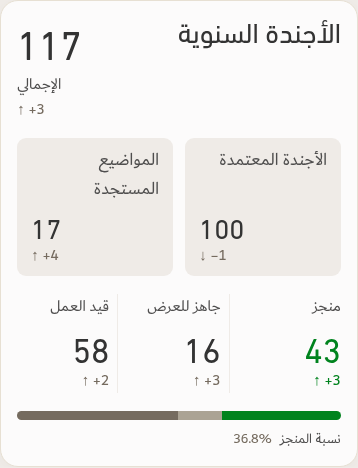

# Approved monthly completion layout — v144

The application and monthly PDF now use separate equal agenda boxes, adjacent completion captions, and a budgeted-project completion bar. Full definitions, validations and limits are in [v144 verification](../Saytara-Verification-v144.md).

The candidate and freshly extracted app each pass 223 browser/PDF checks; an independent source review passes 64 helper checks. Screenshots below are from the final candidate using a frozen illustrative workbook, not the operational workbook from the user's screenshots.

[Continuous PDF rendering](monthly-continuous-page-1.png)

No source workbook or operational data is bundled in the app ZIP. The recorded manifest and runtime hashes connect the tests to the shipped package.
