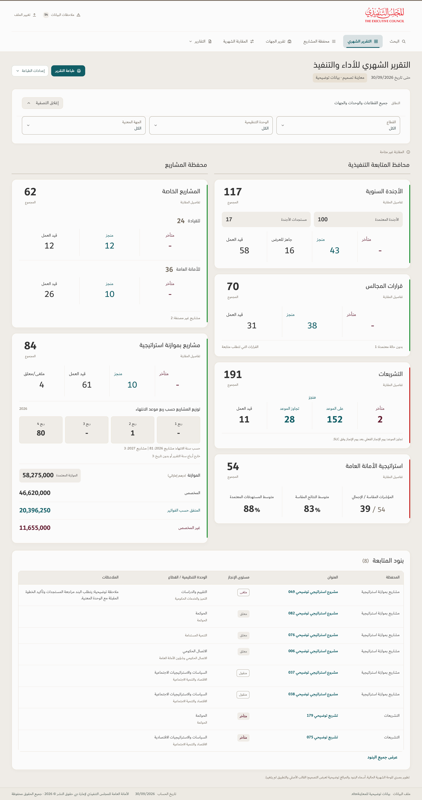

# Current monthly dashboard — TEC Apple-inspired illustration

[View the full-resolution image](Monthly-Dashboard-Current-TEC-Apple.png) · [Download the PDF](Monthly-Dashboard-Current-TEC-Apple.pdf)

This illustration starts from the existing v122 monthly dashboard. The attached projects design and earlier rearranged monthly concept are set aside. The working app and released archive have not changed.

The native monthly structure is preserved. Physical right: annual agenda, council decisions, legislation, then Secretariat strategy. Physical left: special projects, then projects with strategic budgets, including the existing quarter distribution and financial ledger. The native five-column follow-up table remains below both columns, with all eight eligible illustrative rows in the source-defined order. Navigation, print/settings actions and sector/unit/concerned-entity filters are retained.

The styling proposal uses TEC linen behind paper cards, modest corner radii, restrained depth, clearer totals, fine separators and flatter grouping. TEC DIN and Dubai use the bundled local font assets; the original logo and its proportions are unchanged. Ample is available only when installed locally; this renderer uses the existing bundled DIN fallback for headings. Charcoal shadows at 2.5–3% opacity are derived treatments, not additional official palette colors. The monthly source's native bright red/green indicators remain unchanged, alongside the TEC palette and its status text colors.

Repeated unavailable comparison labels are consolidated into the existing visible comparison notice. No historical movements are invented. Metrics, formula eligibility, chart types, missing/zero semantics and drill definitions are preserved. The two overdue legislation items remain within the eleven in progress. KPI values retain the native display precision: 39 measured / 54 registered, 83% mean measured results and 88% mean approved targets, with their separate denominators.

**معاينة تصميم · بيانات توضيحية** is visible beside the historical cutoff, **30/09/2026**. The original mold has 618 unnamed non-KPI rows and blank financial fields. An existing separate anonymized illustrative fixture supplies titles and amounts solely to show the populated monthly layout. It is not an operational report. The original workbook's SHA-256 was checked unchanged. Neither that workbook nor the illustrative workbook is included in these public artifacts.

Verification passed: native card order and physical column positions; six displayed portfolio totals; monthly financial amounts; all eight qualifying table rows; all three scope filters; correct left-to-right ratio/percentage order in Arabic content; loaded Dubai/DIN font faces; no checked label/table overflow; no runtime errors; and a visually inspected PDF containing one complete composition page. Native v122 dashboard source files and released ZIP were compared unchanged. This static illustration does not certify live responsive behavior or accessibility. Artifact hashes are in `SHA256SUMS`.
