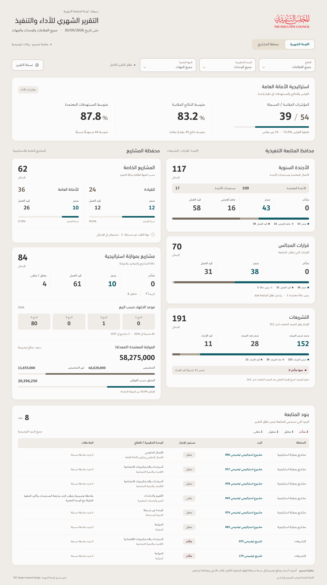

# Monthly dashboard — TEC Apple-inspired design preview

[View the full-resolution image](Monthly-Dashboard-TEC-Apple-Preview.png) · [Download the PDF](Monthly-Dashboard-TEC-Apple-Preview.pdf)

This is a design illustration for review. The released v122 app and its monthly dashboard have not changed.

The proposed hierarchy places strategy indicators above two equal portfolio columns: executive follow-up on the physical right and projects on the physical left. The full-width table beneath contains only the eight qualifying monthly follow-up items in the illustrative model. TEC DIN headings, Dubai body/numerical fonts, the original TEC logo, and the existing TEC palette are retained. Warm neutral surfaces, rounded cards, subtle separators and restrained shadows replace heavy header bands. Shadows use the existing charcoal color with low opacity; no new official brand colors or fonts are introduced.

The image prominently says **معاينة تصميم · بيانات توضيحية**. The source cutoff remains **30/09/2026**. Portfolio titles and financial amounts are illustrative additions in a separate disposable workbook, calculated with the existing monthly rules. The original uploaded mold has 618 unnamed non-KPI rows and blank financial fields; those rows cannot produce named operational totals under the source formulas. The original workbook was not changed. Names and comments in the preview are anonymized examples. No historical changes or trend arrows are invented.

KPI values retain their separate denominators: 39 measured / 54 registered, 83.2% mean measured results, and 87.8% mean approved targets across 49 recorded targets. The two overdue legislation items are within the 11 in progress, not an extra distribution segment. Allocated and unallocated amounts reconcile to the illustrative revised budget; invoice spending uses a separate meter because it overlaps allocation. The two special projects without a requester appear as a comment and remain within the total.

Verified with Chromium: all three local font faces loaded, numerical ratios and percentages retain left-to-right order within Arabic content, executive/projects columns keep their physical positions, all eight table rows are visible, and checked labels have no overflow. All displayed portfolio totals reconcile, and the PDF contains one complete composition page. Source workbook SHA-256 was checked unchanged. This static illustration is not an accessibility certification or a completed responsive implementation. Artifact hashes are recorded in `SHA256SUMS`.
