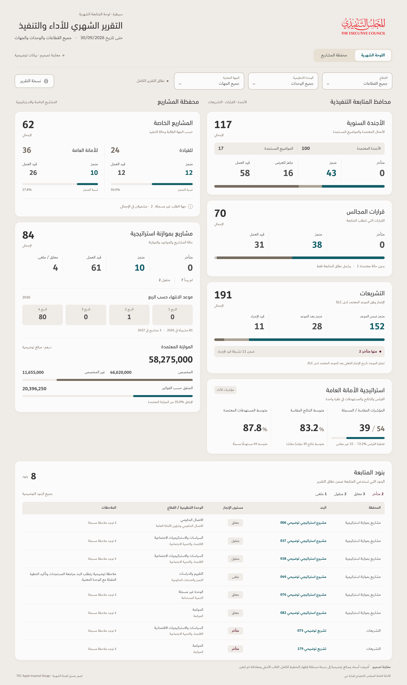

# Monthly dashboard — revised TEC Apple-inspired illustration

[View the full-size image](Monthly-Dashboard-TEC-Apple-Strategy-Original.png) · [Download the PDF](Monthly-Dashboard-TEC-Apple-Strategy-Original.pdf)

Strategy is back in its original position beneath Legislation in the physical right column. Projects remain on the left, with the follow-up table across the full width below both columns. The modern reference's warm surfaces, rounded cards, approved TEC colors, original logo, Dubai body fonts and DIN headings are retained.

Both emerging-topic labels now say **المواضيع المستجدة**. Status legends beneath bars are removed where the labels and figures already appear above them. Unique information remains, including the one council item without a status, two overdue legislation items, completion and coverage percentages, and the invoice-spending denominator. Budget display text reads **الموازنة المعتمدة**; the underlying revised-budget field and calculation are unchanged.

This is a design illustration, visibly marked **معاينة تصميم · بيانات توضيحية**, with the source cutoff **30/09/2026**. It reuses the previous preview's separate illustrative model; names, comments and financial amounts are examples, not verified operational data. The uploaded workbook, its formulas and the released v122 application have not changed. The table shows only the eight qualifying follow-up items in that illustrative model. No historical movement or trend arrows are invented.

Chromium verification confirmed Strategy appears once beneath Legislation, all displayed figures match the prior preview, the corrected labels are present, repeated legends are absent, and all three TEC font faces load. Arabic text and numerical ratios render correctly, with no checked label overflow. The full-size PNG is 2880 × 4834 pixels; the PDF contains one complete composition page. The workbook and v122 ZIP hashes remain unchanged. Artifact hashes are recorded in `SHA256SUMS`. This illustration is not a completed responsive implementation or an accessibility certification.
