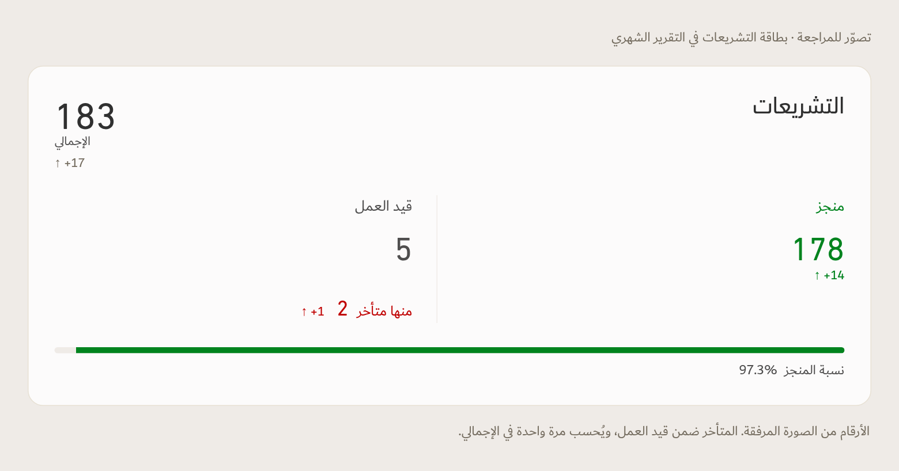

# Monthly legislation card — illustration for review

This is a proposed monthly card, not a change to the live monthly report. Figures come from the user's screenshot: total 183 (+17), completed 178 (+14), in progress 5, late 2 (+1). The current source calculation includes late items within in-progress items. The illustration therefore places **منها متأخر 2** beneath **قيد العمل 5**, with no double counting. Completion is 178 / 183 = 97.3%. No in-progress comparison is invented.

The proposal replaces the two displayed SLC completion groups with one **منجز** figure. Applying that change to the monthly report still requires the user's approval and confirmation against the revised workbook. No source workbook was modified.

[HTML illustration](index.html) · [Phone preview](monthly-legislation-phone.png)

Uses the existing bundled Dubai/DIN fonts and approved TEC colors. Desktop/phone rendering and arithmetic were checked; this is not a new source-data audit.
