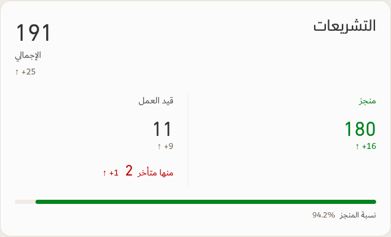
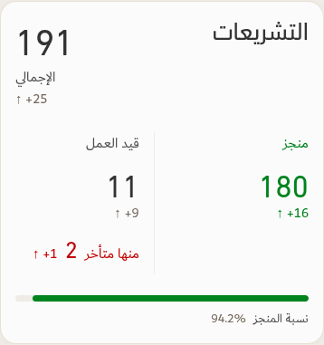

# Applied monthly legislation card — v157

[Download app](../Performance-App-v157.zip) · [Verification](../Saytara-Verification-v157.md) · [Updated skill and principles](../TEC-Apple-Inspired-Skill-and-Principles.zip)

The approved monthly card now combines both completed SLC groups into **منجز**, shows **قيد العمل**, and places **منها متأخر** beneath the in-progress figure when the source supports that subset. Late items are not counted again. The Green/Linen bar uses completed legislation divided by the full scoped total, with **نسبة المنجز** beside the percentage.

Filters and drilldowns use exact source records. Prior changes require eligible source history; missing or contradictory historical components do not become fabricated arrows. Underlying SLC source categories are retained. The same card appears in native continuous and A4 PDF output.

Preview/test figures follow the existing illustrative workbook. The separately labelled approved-example test uses controlled input; no example counts are hardcoded into the app.

See the verification file for the actual tests and their limits.
