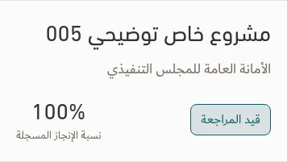
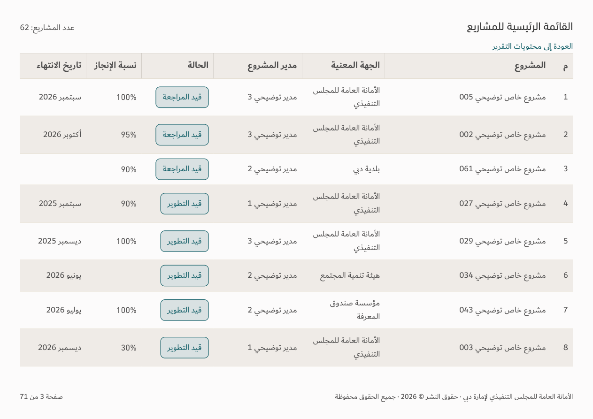

# Numeric progress and HH PDF cleanup — v156

[Download app](../Performance-App-v156.zip) · [Verification](../Saytara-Verification-v156.md) · [Updated skill and principles](../TEC-Apple-Inspired-Skill-and-Principles.zip)

Harvey balls and circular recorded-progress indicators are removed. Exact numeric percentages remain in app tables/cards, entity details, PDF and editable HH PowerPoint exports. Zero remains a dash and missing values remain blank. Source records and calculations are preserved.

The native HH PDF no longer repeats the combined overview card after the paired chart page. Report contents, charts, definitions and project details remain.

The separate [monthly legislation illustration](../Monthly-Legislation-Concept-v156/README.md) is for review only. The monthly report is unchanged in this release.

Actual browser/PDF and native PowerPoint structure/data checks are documented in the verification file. Office visual rendering was unavailable.
