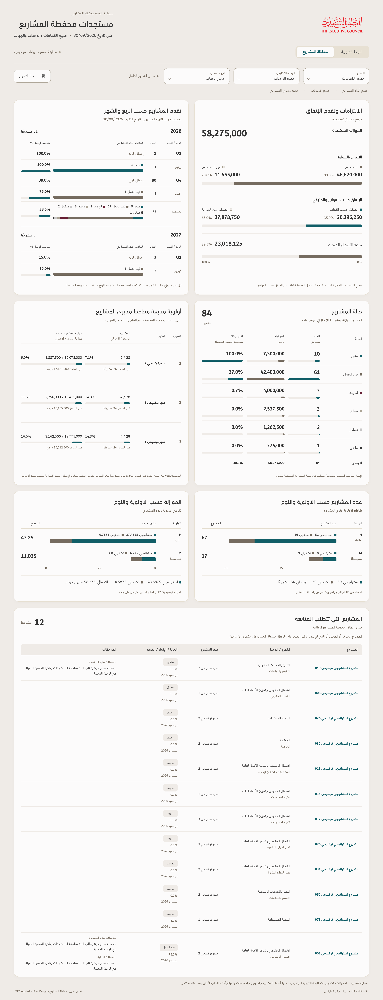

# Projects dashboard — TEC Apple-inspired illustration

[View the full-size image](Projects-Dashboard-TEC-Apple-Preview.png) · [Download the PDF](Projects-Dashboard-TEC-Apple-Preview.pdf)

The approved monthly dashboard is the visual standard: the same TEC logo, exact colors, Dubai body and numerical fonts, DIN headings, header, scope controls, warm surfaces, rounded cards, spacing and restrained shadows. The requested six panels keep their physical pairings:

| Physical left | Physical right |
| --- | --- |
| Quarter and month progress | Commitments and expenditure |
| Project manager follow-up priority | Combined project status, count, budget and average progress |
| Budget by priority and type | Project count by priority and type |

The full-width five-column table contains only the twelve projects qualifying under the existing project-follow-up rules: overdue open projects, suspended projects, projects that have not started, or known-status noncompleted projects with recorded notes. Completed projects with historical notes are excluded. Each qualifying project appears once; complete notes are retained, with empty notes left blank. There is no reason-for-follow-up column.

Only populated status and priority groups appear. The empty unknown-status category and empty L priority are hidden; populated H and M groups remain. Empty quarters and months are omitted without changing schedule membership or totals. A recorded 0% remains visible for an existing category. Missing values are not converted to zero. Direct labels above bars replace repeated legends; type totals beneath priority charts add aggregate information. Budget wording is **الموازنة المعتمدة**. Invoice spending and the value of completed work remain separate measures.

This is a static design illustration, visibly labelled **معاينة تصميم · بيانات توضيحية**, using the same separate anonymized workbook as the monthly preview, with cutoff **30/09/2026**. Names, managers, notes and financial values are illustrative additions. The original uploaded workbook, its formulas and the released v122 app are unchanged. The original mold's unnamed rows cannot produce operational named-project totals under its formulas; preview figures should not be treated as verified live results. No historical comparisons or arrows are invented.

Native v122 calculations and an independent workbook calculation agree on the illustrative model: 84 projects; mean recorded progress 38.9%; H 67 and M 17; 81 projects in 2026 and 3 in 2027; approved budget 58,275,000; allocated 80%; invoice spending 35%; completed work value 39.5%; and twelve qualifying follow-up projects. Status counts, financial sums, type-by-priority intersections, manager rankings and the exact follow-up row set reconcile. Manager rankings use 50% unfinished-count share and 50% unfinished-budget share; the displayed manager bars show completed versus total counts and project budgets, rather than spending. The model has three managers and no fully completed manager portfolio, so no extra comparison row is invented.

Chromium checks and visual inspection confirmed all three TEC font faces load, numerical fractions keep their left-to-right order, the six panels retain their physical positions, chart labels and widths match the model, and all qualifying table rows and notes render without checked overflow. The PNG is 2880 × 7510 pixels; the PDF contains one complete composition page. The workbook, preview fixture and v122 ZIP hashes remain unchanged. Artifact hashes are in `SHA256SUMS`. This preview is not a completed responsive implementation or an accessibility certification.
