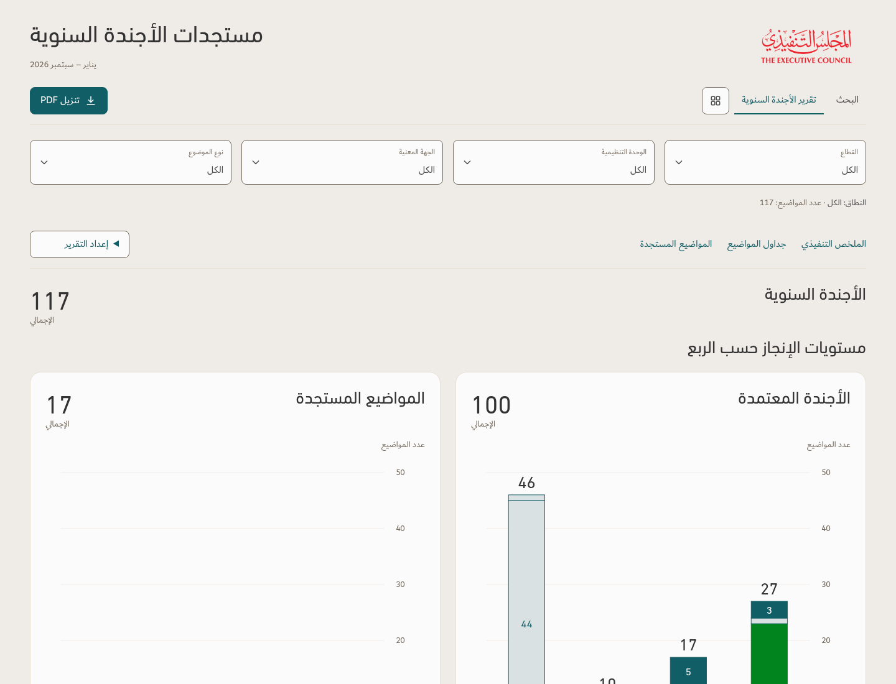
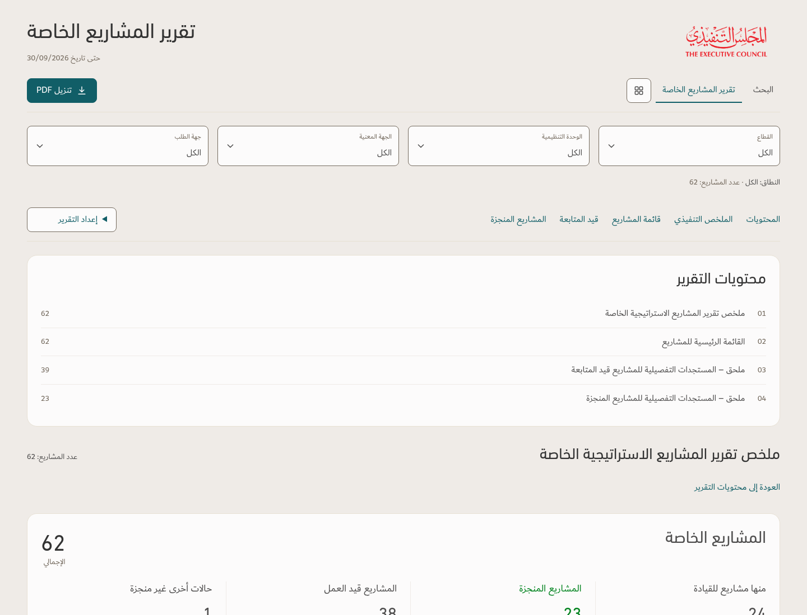
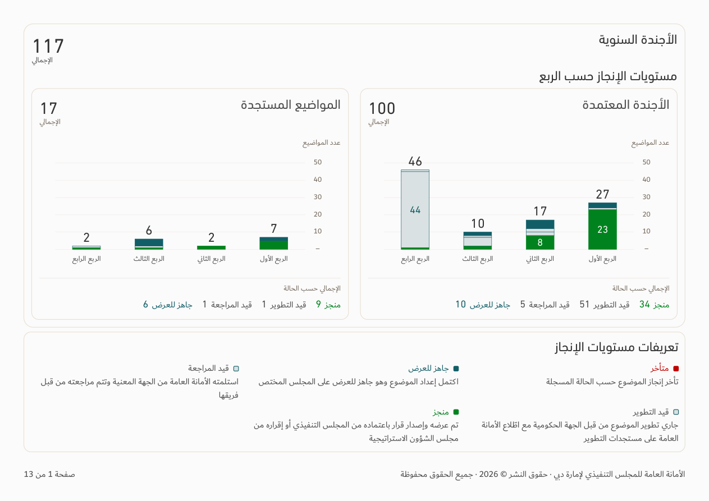
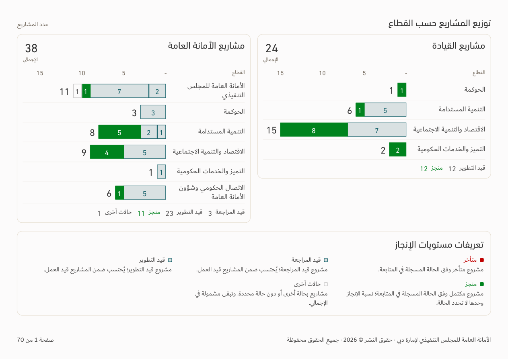

# Agenda and special-project reports — v158

[Download app](../Performance-App-v158.zip) · [Verification](../Saytara-Verification-v158.md) · [Updated skill and principles](../TEC-Apple-Inspired-Skill-and-Principles.zip)

Both report pages now use the same TEC presentation roles throughout their headers, scope filters, report settings, navigation, chart cards, status totals, legends, section headings, tables and mobile record cards. Each retains its source content, calculations and approved chart orientation.

The agenda PDF no longer adds separate count-matrix pages. The chart and full definitions remain together, followed by the original topic tables. The special-project main list has six columns without PM; source manager information remains in detailed project cards. Native PDF and editable PowerPoint tables share Paper bodies, Linen headers and fine horizontal separators.

Full-bleed PDF covers retain centered title, selected entity and period; footer numbering starts after the cover. No example figures are hardcoded. Previews and test artifacts use the existing **illustrative** workbook (September 2026), not a newly supplied production source.

See verification for scope and limitations; PowerPoint XML/data/geometry was checked, but Office rendering/editing was unavailable.
