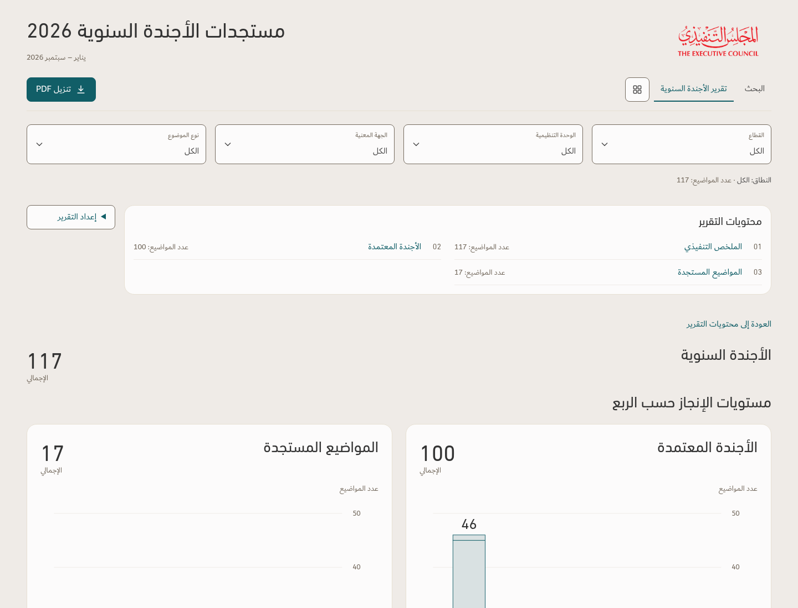
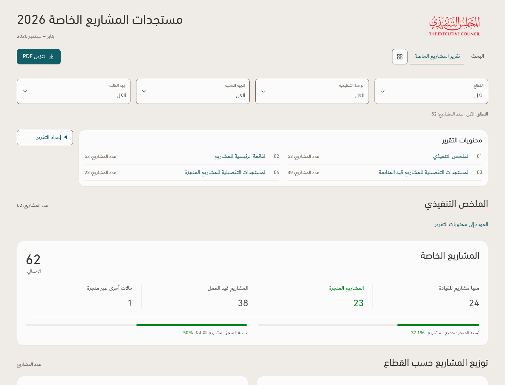
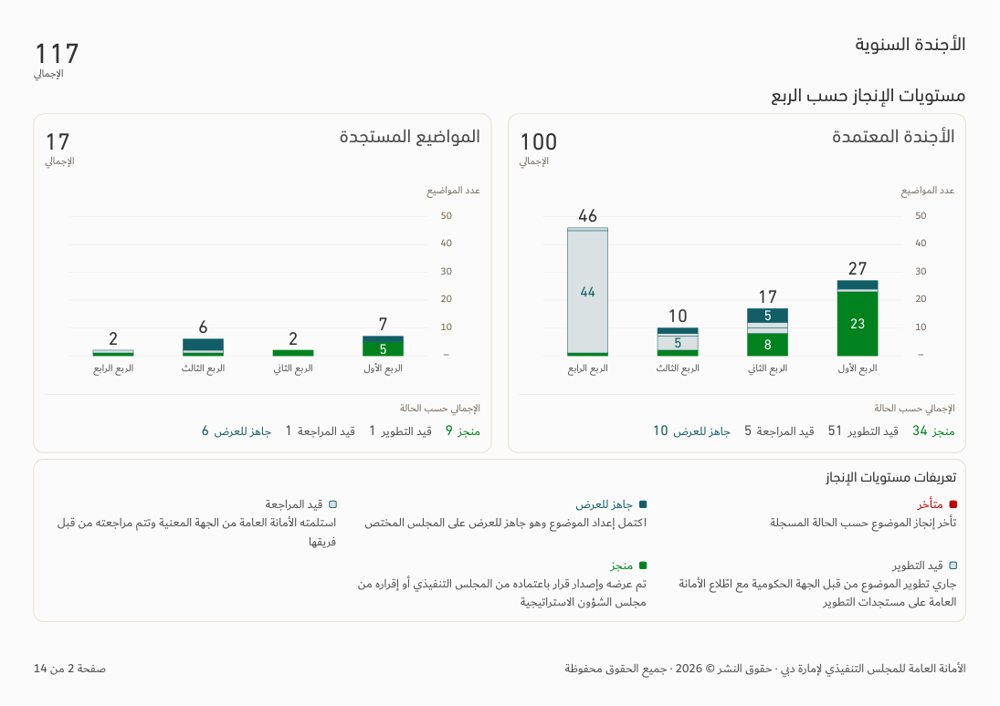
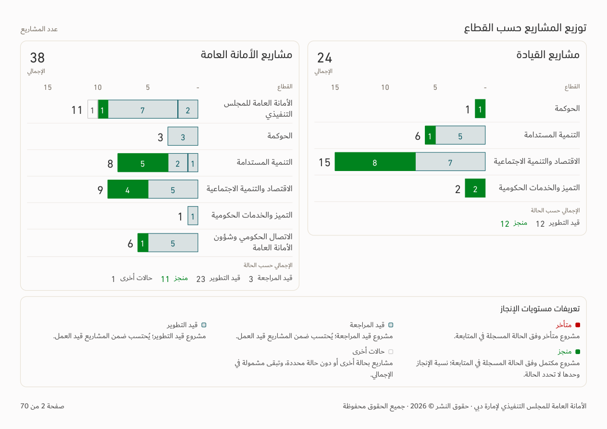

# Shared agenda and special-project reports — v161

[Download app](../Performance-App-v161.zip) · [Full recommendations and approach](APPROACH.md) · [Verification](../Saytara-Verification-v161.md) · [Updated principles](../Design-Standard/TEC-Apple-Inspired-Design-Standard-Revision-26.md)

Both reports now share contents/navigation, reading order, table-column order, continuous record numbering, cover titles, final notes/recommendations and compact legends. **المستجدات التفصيلية** appears only in special projects. PDF contents shows actual page references and working links; numbering and copyright begin after the cover.

These previews use the existing illustrative workbook. Source records and calculations are preserved. No workbook is bundled with the app.

## Screen

## PDF charts and compact definitions

## Front pages, contents and tables

[Agenda cover](agenda-cover.png) · [Special-project cover](special-projects-cover.png) · [Agenda contents](agenda-contents.png) · [Special-project contents](special-projects-contents.png) · [Special-project table](special-projects-table.png)

[Agenda phone](agenda-phone.png) · [Special-project phone](special-projects-phone.png)
