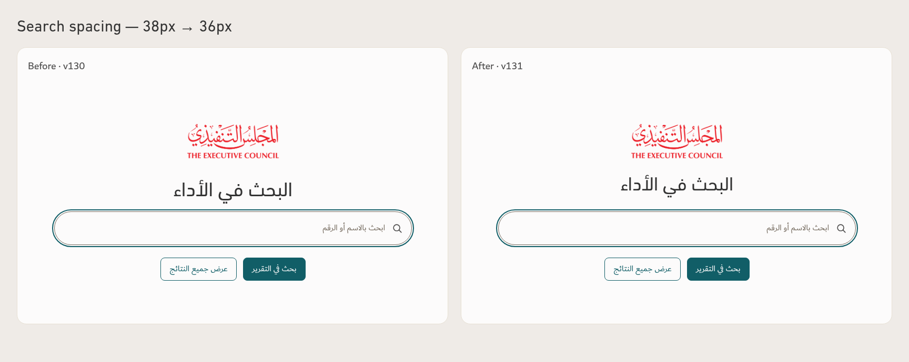
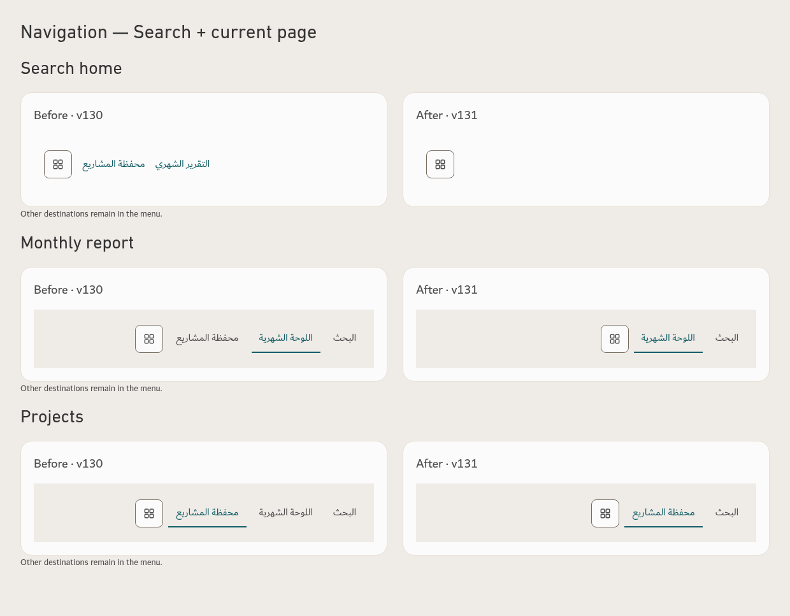
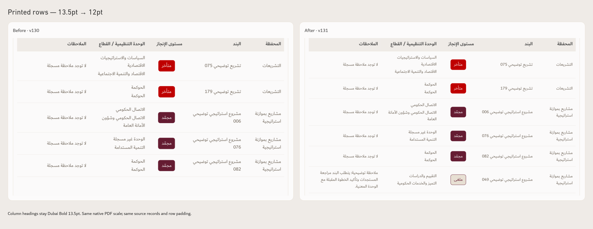
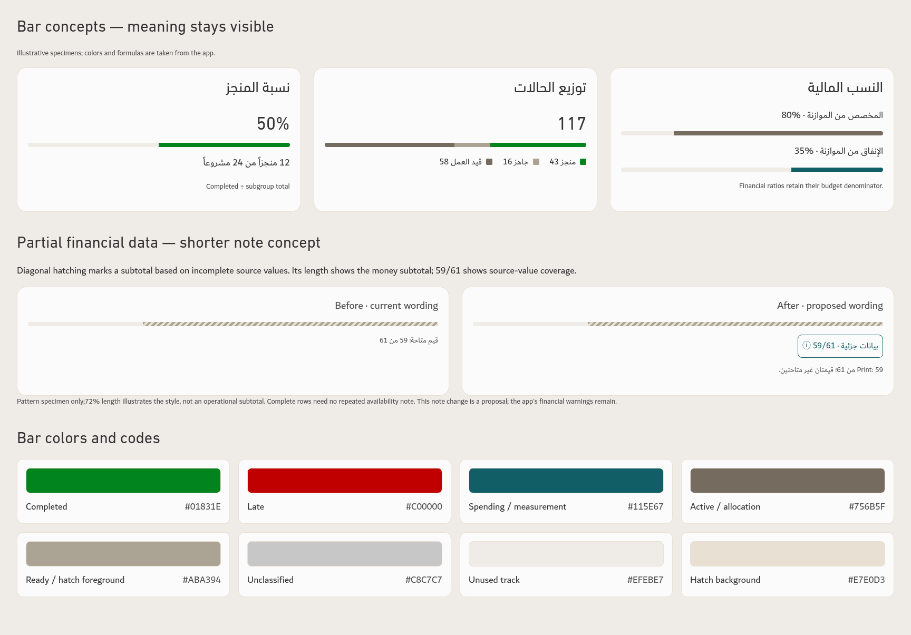

# Search, navigation, print and bar guide

[Download updated app v131](https://github.com/ormbh/Performance-App-2/raw/refs/heads/main/Performance-App-v131.zip) · [Download the complete visual guide](https://github.com/ormbh/Performance-App-2/raw/refs/heads/main/TEC-Search-Navigation-Print-Bar-Guide.zip) · [All information tables](GUIDE.md) · [Current design standard](../Design-Standard/TEC-Apple-Inspired-Design-Standard-Revision-6.md)

The requested search/title, contextual navigation and printed-table sizing changes are implemented in v131. The compact partial-data note is a separate proposed clarification. Chart calculations and colors are retained.

All app captures use native CSS pixels at 100% browser zoom/device scale 1. Report records and financial examples are illustrative. No operational workbook or uploaded operational PDF is included. Native PDF table comparisons use the same physical scale; row content wraps at its actual font size.

| Comparison | Native image |
| --- | --- |
| Search title 38→36px, centered in unchanged logo-to-field gap | [Search spacing](comparisons/search-comparison.png) |
| Home menu only; Search+current page elsewhere | [Navigation](comparisons/navigation-comparison.png) |
| Printed table body/status 13.5→12pt | [Native print comparison](comparisons/print-comparison.png) |
| Bar meanings/colors and proposed partial-data note | [Bar specimens and swatches](comparisons/bar-concepts.png) |
| Typography data-point map for the supplied screenshot | [Reference table](comparisons/typography-reference.png) |

Printed table content and in-table statuses are now 12pt (16 CSS px); screen content/status text stays 16px. Column headings remain 18px on screen and 13.5pt in print. Two CSS pixels smaller is a 1.5pt reduction. Print padding, font families, title and footer sizes remain.

A hatched financial bar marks incomplete source values. «قيم متاحة:59 من 61» means two projects lack usable numeric values for that metric. Bar length encodes the money subtotal; 59/61 encodes numeric coverage. Proposed wording: «بيانات جزئية · 59/61», with focus/tap details and a short visible print qualification. Full-coverage notes can be omitted; missing values must remain disclosed.

Native PDFs: [Before monthly](monthly-before-a4.pdf) · [After monthly](monthly-after-a4.pdf) · [Before search](search-before-a4.pdf) · [After search](search-after-a4.pdf).

[Exact bar/source definitions](BAR-AUDIT-v130.md) · [Screen geometry evidence](screen-concept-evidence.json) · [Mobile/type role evidence](extra-evidence.json) · [Native print evidence](print-concept-evidence.json) · [v131 verification](../Saytara-Verification-v131.md).

For interactive details, extract the guide ZIP and open index.html. App downloads and guide downloads are separate ZIP files.
