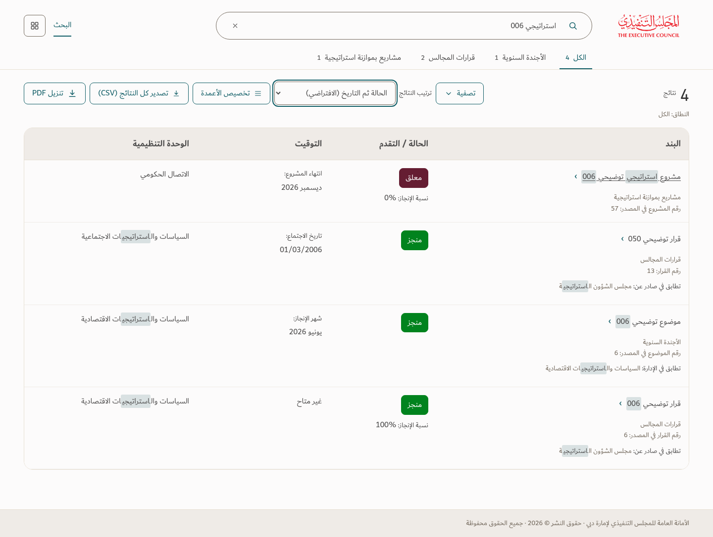

# Approved search results — v145

The approved results concept is implemented. The shared prompt is **ابحث عن بند أو مشروع أو مسؤول**. Default desktop results use four columns; phones show readable rows, with secondary actions in the options control. Saved column choices, actual record details, matching rules and full-match exports remain available. Scope summaries use the first selected name **+N** or **الكل**.

The candidate passes 101 browser/PDF checks; the fresh ZIP extraction passes 99. Source review and interaction evidence are included. See [verification and limits](../Saytara-Verification-v145.md). Images use a frozen illustrative workbook, not operational records. No workbook is bundled.

[Phone results](results-390.png) · [Narrow phone](results-320.png) · [All six selected fields on phone](custom-six-columns-320.png) · [Search prompt](home-390.png)
