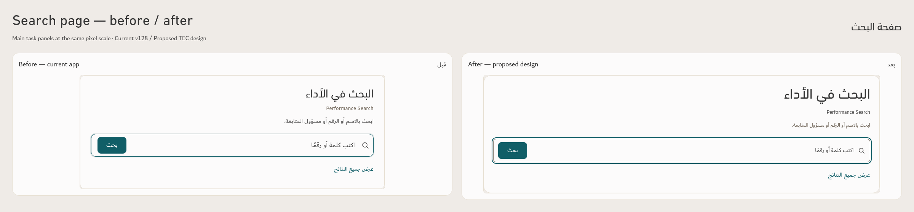
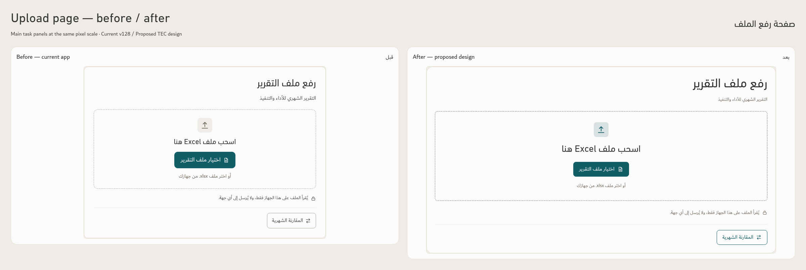

# Search and upload — before / after

Visual previews using the approved [TEC Apple-Inspired Design standard, Revision 2](https://github.com/ormbh/Performance-App-2/blob/5c745e8ada3258c031de3da1040952cc6f2b1808/Design-Standard/README.md). **The working app and its source data remain unchanged.**

Before shows the actual Performance App v128. After illustrates the approved design using the same content and workflow. The comparison sheets place the current page on the left and the proposed page on the right.

## Full-size views

Open a PNG at its native size to judge the type. Desktop captures use a 1920px viewport, 100% CSS scale and device scale factor 1. The task comparison sheets crop the main panels and preserve the same pixel scale on both sides.

| View | Actual current page | Proposed page | Side-by-side full pages |
| --- | --- | --- | --- |
| Search landing | [Before](TEC-Search-Before.png) | [After](TEC-Search-After.png) | [Compare](TEC-Search-Before-After.png) |
| Search results | [Before](TEC-Search-Before-Results.png) | [After](TEC-Search-After-Results.png) | [Compare](TEC-Results-Before-After.png) |
| Search with no matches | [Before](TEC-Search-Before-No-Match.png) | [After](TEC-Search-After-No-Match.png) | — |
| Initial upload | [Before](TEC-Upload-Before.png) | [After](TEC-Upload-After.png) | [Compare](TEC-Upload-Before-After.png) |

[Search on mobile](TEC-Search-After-Mobile.png) · [Search results on mobile](TEC-Search-After-Results-Mobile.png) · [Upload on mobile](TEC-Upload-After-Mobile.png)

## What changes

| Area | Current page | Proposed standard |
| --- | --- | --- |
| Search / upload page title | 30px DIN Regular | 38px DIN Next Arabic Regular |
| Search-results title | 26px DIN Regular | 38px DIN Next Arabic Regular |
| Upload drop-zone heading | 22px DIN Regular | 28px DIN Next Arabic Regular |
| Search table headings | 17px DIN Regular | 18px Dubai Bold, Ink on Linen |
| Search table names / notes | Existing mixed role sizes; names 18px | 16px Dubai Regular, neutral Taupe on Paper |
| Supporting explanation | 16px on these pages | Approved 14px Dubai Regular |
| Buttons and input values | Existing 16–18px controls | 16px Dubai Regular, minimum 44px targets |
| Main task panel | Search 800px / upload 720px | Focused 1040px panel; reflows on mobile |
| Shared desktop header / results | Existing bounded content area | Fluid layout with 48px gutters |
| Status identity | Existing outline treatments | Approved distinct 18px badges; completed green, frozen Burgundy |
| Mobile | Existing app layout | 16px gutters, readable controls and reflowed results |

The illustrations retain the supplied TEC logo and actual bundled DIN / Dubai fonts. Action buttons, fields, selected tabs, focus, disabled actions, borders and surfaces follow the approved component rules. Upload retains one primary choose-file action, the existing Excel workflow and privacy statement.

## Preview gallery

Download and extract [TEC-Search-Upload-Preview.zip](TEC-Search-Upload-Preview.zip) (about 7MB), then open **index.html**. Choose Search, Search results or Upload; switch between Before, After and Compare; use **Actual size (100%)** for the full screenshot scale. The gallery includes the PNGs and HTML screen snapshots with their bundled fonts and assets. Keep the extracted `preview-assets` folder beside the snapshots.

The gallery controls work. The individual HTML page snapshots are visual illustrations with app scripts removed; use the working app for real search and upload operations.

## Verification and content scope

- Baseline index, CSS and JavaScript hashes match the actual v128 release ZIP.
- Search uses `ILLUSTRATIVE-monthly-preview.xlsx` in both versions. The same query, `استراتيجي 006`, returns the same four records before and after; row content and source model are unchanged. This is illustrative data, not a live reporting snapshot.
- The no-match model remains zero; the displayed count uses **–**. Meaningful source-backed 0% completion remains visible.
- Computed browser styles confirm the supplied fonts, agreed sizes, weights and palette. Names stay neutral and regular; match underlines preserve their text color.
- Desktop and 390px mobile layouts were visually inspected; neither proposed page has overall horizontal overflow. Search results reflow into readable mobile records.
- Upload's native file chooser was checked with pointer, Enter and Space. Invalid-file feedback and loading guards were checked in the isolated browser preview.
- The actual app's CSS and JavaScript hashes remain unchanged. This task creates previews; it does not implement the new app design or produce a new release.
- The ZIP shares identical font/image assets to keep the download compact. All eight packaged HTML screens were checked against the original snapshots: desktop pixels match, no new font errors are introduced, and all four proposed screens fit a 390px mobile viewport.

Evidence: [Search](evidence/search-evidence.json), [Upload](evidence/upload-evidence.json), [Gallery](evidence/gallery-evidence.json), [Download package](evidence/package-evidence.json), and [independent review](evidence/independent-review.md).

The monthly page remains the first implementation target, as agreed. This preview does not change the approved print rule: the entity filter, its label and selected-value field are omitted from printed reports while its selection still filters the report content.
