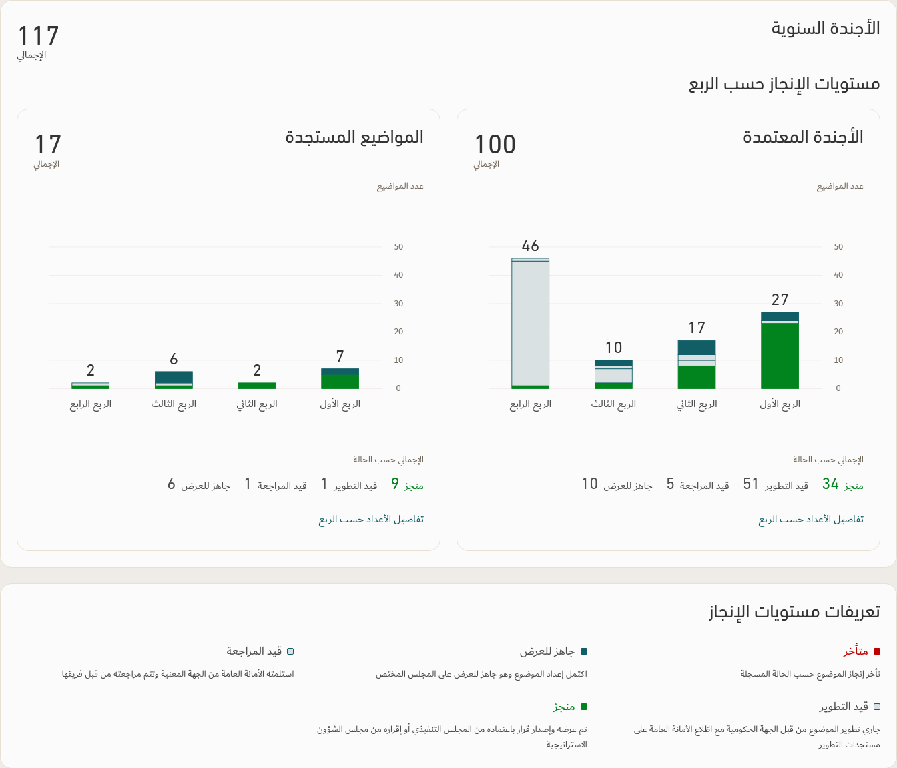
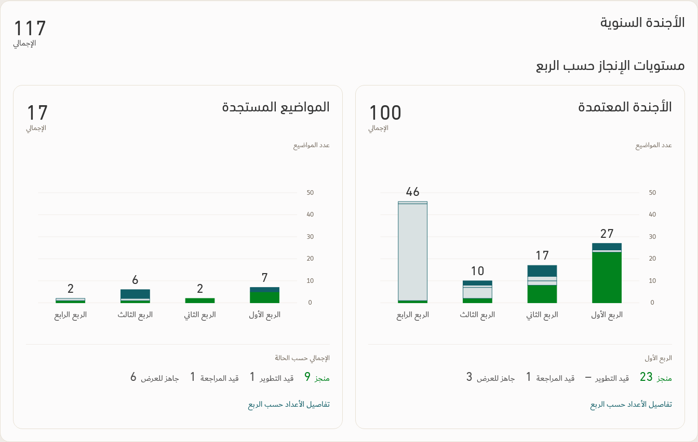
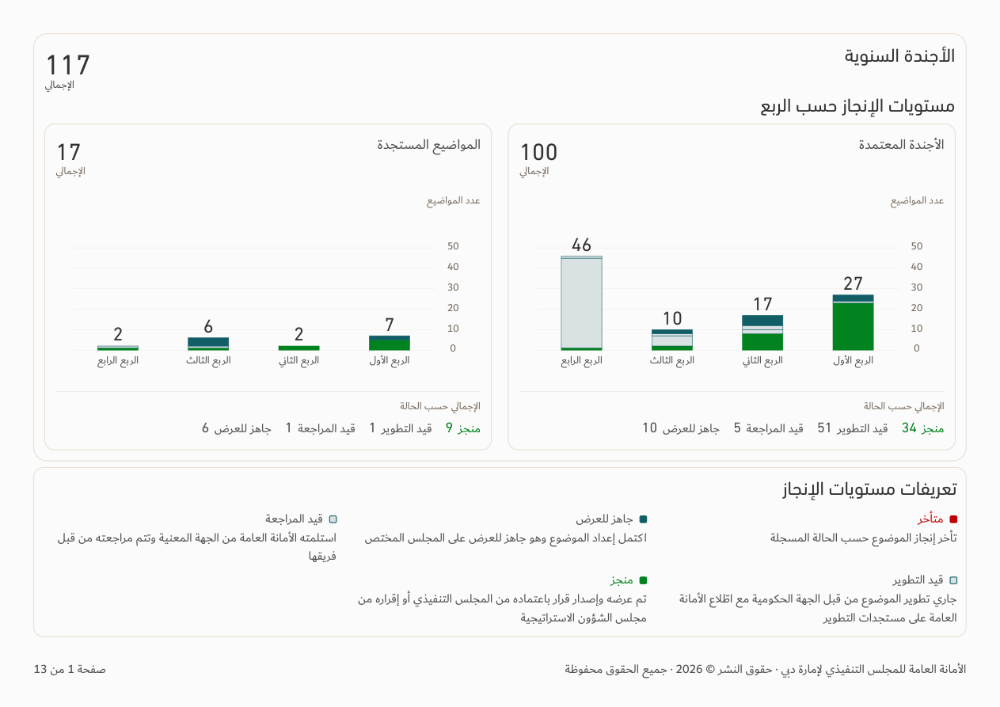
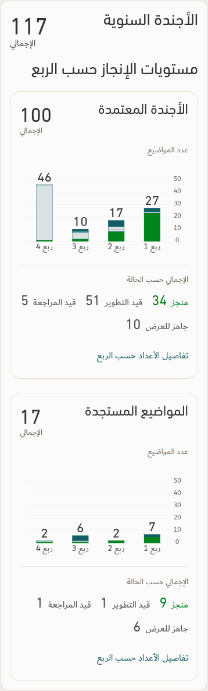

# Status consistency and agenda totals — v154

[App download](../Performance-App-v154.zip) · [Updated TEC skill and principles](../TEC-Apple-Inspired-Skill-and-Principles.zip) · [Revision 21 principles](../Design-Standard/TEC-Apple-Inspired-Design-Standard-Revision-21.md) · [Verification](../Saytara-Verification-v154.md)

One shared status appearance governs badges, chart marks, legends and exports. Agenda charts show category totals by status by default; quarter activation shows the quarter breakdown, with no persistent selection outline. PDFs always use aggregate totals, including after a quarter activation.

The previews use an illustrative workbook. Actual report values follow the selected source and scope.

