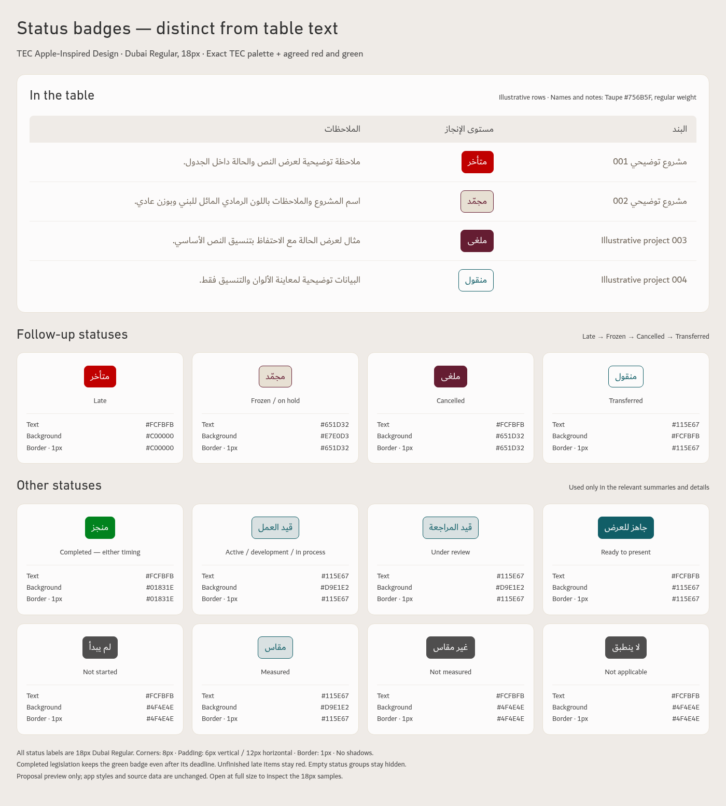

# TEC status badge color proposal

Updated preview of the selected status badge colors, distinct from the main table text colors. The typography specification is retained: names and notes use Dubai Regular, 18px, Taupe #756B5F; table headers use Ink #4F4E4E on Linen #EFEBE7. This preview loads the actual bundled DIN Next Arabic Regular and Dubai Regular fonts at device scale 1. Sample rows are illustrative. App files and workbook data are unchanged.

[Open the full-size status preview](TEC-Status-Badge-Proposal.png)

## Badge colors

| Status | Text | Background | Border | Text/background contrast |
| --- | --- | --- | --- | --- |
| متأخر | Paper #FCFBFB | Red #C00000 | Red #C00000 | 6.27:1 |
| مجمّد / معلّق | Burgundy #651D32 | Sand #E7E0D3 | Burgundy #651D32 | 9.01:1 |
| ملغى | Paper #FCFBFB | Burgundy #651D32 | Burgundy #651D32 | 11.45:1 |
| منقول | Teal #115E67 | Paper #FCFBFB | Teal #115E67 | 7.21:1 |
| منجز | Paper #FCFBFB | Green #01831E | Green #01831E | 4.77:1 |
| قيد العمل / قيد التطوير / قيد الإجراء | Teal #115E67 | Mist #D9E1E2 | Teal #115E67 | 5.61:1 |
| قيد المراجعة | Teal #115E67 | Mist #D9E1E2 | Teal #115E67 | 5.61:1 |
| جاهز للعرض | Paper #FCFBFB | Teal #115E67 | Teal #115E67 | 7.21:1 |
| لم يبدأ | Paper #FCFBFB | Ink #4F4E4E | Ink #4F4E4E | 8.03:1 |
| مقاس | Teal #115E67 | Mist #D9E1E2 | Teal #115E67 | 5.61:1 |
| غير مقاس / لا ينطبق | Paper #FCFBFB | Ink #4F4E4E | Ink #4F4E4E | 8.03:1 |

All badges use Dubai Regular, 18px, an 8px corner radius, 6px vertical and 12px horizontal padding, a 1px border, and no shadow. Width follows the label. These are informational status badges rather than action buttons. Paired Arabic labels above share a treatment; the interface retains the applicable source-backed label rather than displaying combined aliases.

Exact colors come from the existing TEC palette, with user-agreed completed green and late red as status exceptions. No derived tints or additional palette colors are introduced. Paper is the warm-white label color on solid badges. A status color belongs to the badge treatment; table names and notes stay neutral and regular weight. Numerical values keep their separately agreed color roles.

Completed legislation remains green whether completion is within or after its deadline. Unfinished late items remain red. Follow-up tables retain the order late → frozen → cancelled → transferred and their existing inclusion rules. Other statuses appear only in the relevant views. Empty status groups are hidden.

The numerical contrast checks exceed 4.5:1 for each 18px regular badge label. This check is not an accessibility certification. The image was inspected for Arabic shaping, mixed text direction, label clipping, colors, font size, regular weight, and alignment.

This folder is a design preview. No application release or source-data change is included.
