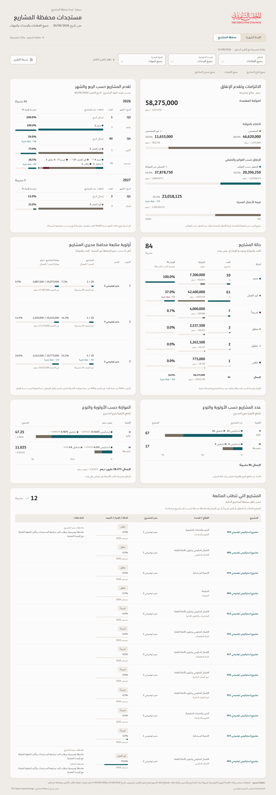
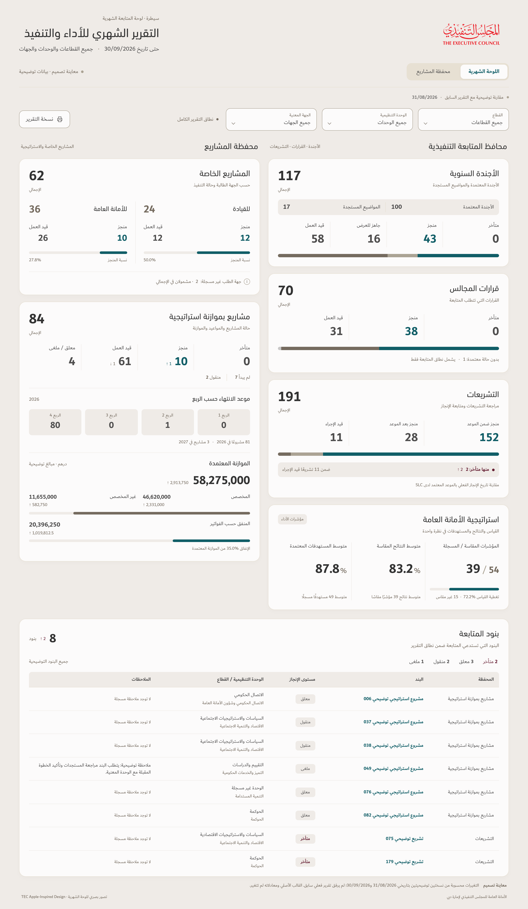

# TEC Apple-inspired illustrations — changes since the previous report

Latest revision: [status colours and ordered follow-up tables](TEC-Apple-Status-Colors-Illustrations.md). The figures and table membership below describe this earlier preview.

| Illustration | Full-size image | PDF |
| --- | --- | --- |
| Projects | [View](Projects-Dashboard-TEC-Apple-Change-Arrows.png) | [Download](Projects-Dashboard-TEC-Apple-Change-Arrows.pdf) |
| Monthly report | [View](Monthly-Dashboard-TEC-Apple-Change-Arrows.png) | [Download](Monthly-Dashboard-TEC-Apple-Change-Arrows.pdf) |

Both illustrations now show compact **↑/↓ differences from the previous report**, alongside the existing completion percentages and bars. Unchanged or unavailable differences are hidden. Percentage differences use **نقطة مئوية**; money uses the unit shown with the figure or in the chart heading. General counts and money changes are neutral, completion increases are teal, and increases in overdue or follow-up counts are burgundy. These are descriptive differences within each group; they do not establish that an individual project stalled.

The monthly Agenda card uses **الأجندة المعتمدة** and **المواضيع المستجدة**. The Legislation subtitle is **مراجعة التشريعات ومتابعة الإنجاز**. Its SLC explanation appears once at the bottom, below the overdue inset: **مقارنة تاريخ الإنجاز الفعلي بالموعد المعتمد لدى SLC**. Strategy remains below Legislation in the physical right column. Budget wording remains **الموازنة المعتمدة**.

Projects retain the approved six panels in three paired rows, followed by the five-column table of twelve qualifying follow-up projects. Empty status and H/M/L groups stay hidden, while recorded zero progress remains visible. Both illustrations retain the legend rule: a bar's labels and figures are not repeated underneath it when already identified above.

The arrows compare **two synthetic illustration snapshots**, dated **31/08/2026** and **30/09/2026**, using native v122 comparison calculations and independent workbook checks. No operational previous report was supplied. The current preview workbook and all approved current figures are unchanged. For example, the projects sample changes from 9 to 10 completed projects (**↑1**), 62 to 61 active projects (**↓1**), and 38.2738% to 38.8690% average completion (**↑0.6 percentage points**). Its follow-up count changes from 13 to 12 (**↓1**). Monthly follow-up changes from 6 to 8 (**↑2**), due to two legislation items becoming overdue at the later sample cutoff. Incomplete Council record identities were preserved; no Council movement is illustrated.

Both images visibly disclose illustrative data and comparison. Names, managers, comments and financial values are examples. These are standalone design previews; the original uploaded workbook, formulas and released v122 app are unchanged.

Checks confirmed exact native deltas, unchanged current values and memberships, correct chart widths, loaded TEC fonts, readable Arabic and isolated numerical fractions, preserved physical positions, absent repeated legends, and no checked clipping, overflow or runtime errors. Projects show 32 nonzero change badges and the monthly report shows 8. PNG sizes are **2880 × 8284** and **2880 × 4954** respectively. Each PDF contains the complete composition on one page for zoomable review. Hashes are in `SHA256SUMS`.

