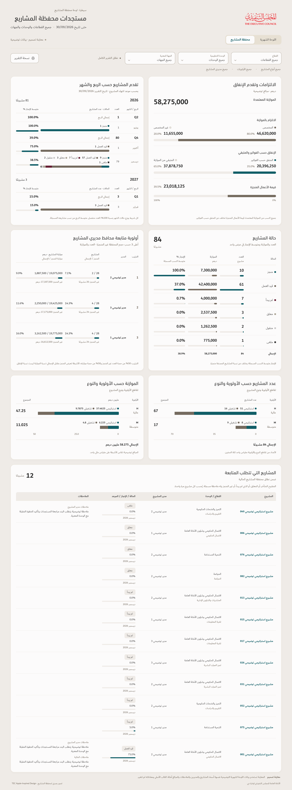
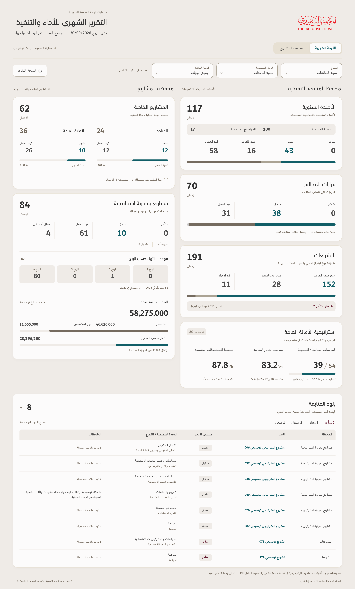

# TEC Apple-inspired illustrations — legends and recorded progress

| Illustration | Full-size image | PDF |
| --- | --- | --- |
| Projects | [View](Projects-Dashboard-TEC-Apple-Legends-Progress.png) | [Download](Projects-Dashboard-TEC-Apple-Legends-Progress.pdf) |
| Monthly report | [View](Monthly-Dashboard-TEC-Apple-Legends-Progress.png) | [Download](Monthly-Dashboard-TEC-Apple-Legends-Progress.pdf) |

The same legend rule applies to both: labels and figures already identifying a bar are not repeated underneath it. Projects retain the direct status labels above each monthly stack and the type labels above each H/M bar, where they identify otherwise unlabeled segments. The repeated colored type-total legends below the priority charts are removed; the plain overall count and budget totals remain.

Projects retain all status, month and manager progress percentages and meters. The twelve qualifying follow-up rows now also show a meter beside each recorded percentage: ten recorded 0% values, one 5%, and one 75%. Missing values would produce no meter. Empty L and unknown-status categories remain hidden. Source membership, totals, ranking rules and chart scales are unchanged.

The monthly Legislation subtitle now defines the timing comparison once: **مقارنة تاريخ الإنجاز الفعلي بالموعد المعتمد لدى SLC**. The repeated lower SLC note is removed. The three directly labelled status counts, distribution bar and unique note that two overdue items are within the eleven in progress remain. Strategy stays below Legislation in the physical right column. All five existing progress meters, percentages, portfolio figures and eight follow-up rows are preserved.

Both are standalone design illustrations using the same separate anonymized preview models as before, with source cutoff **30/09/2026**. The images visibly disclose **معاينة تصميم · بيانات توضيحية**. Names, managers, comments and financial amounts are illustrative. The original workbook, formulas, fixture and released v122 app are unchanged. Progress in these illustrations means recorded completion or the explicitly named ratio; previous-report change arrows require a confirmed comparable earlier snapshot and are not inferred from completion percentages.

Native rendering and independent checks confirmed unchanged numerical values and memberships, correct bar widths, necessary direct labels, absent repeated legends, loaded TEC font faces, readable Arabic and numerical fractions, preserved physical pairings, and no checked overflow or runtime errors. Both PDFs contain one complete composition page and were visually inspected. The PNGs are 2880 × 7766 pixels for projects and 2880 × 4772 pixels for the monthly report. Artifact hashes are in `SHA256SUMS`. These static previews are not a completed responsive implementation or an accessibility certification.

