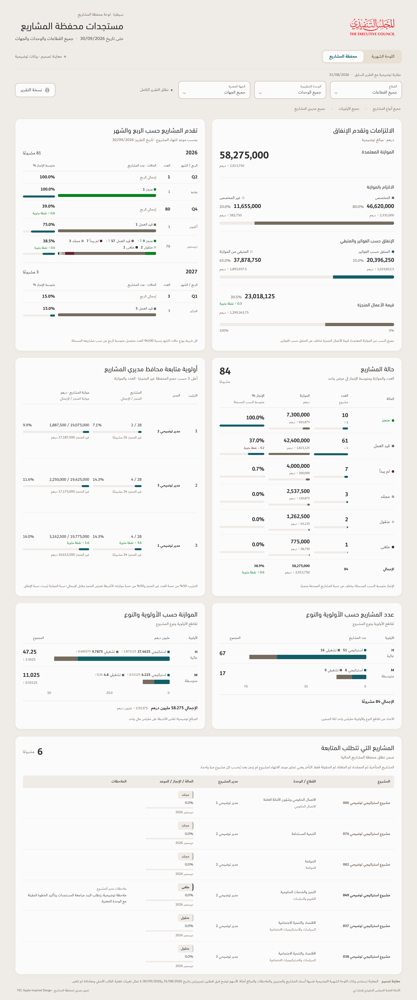
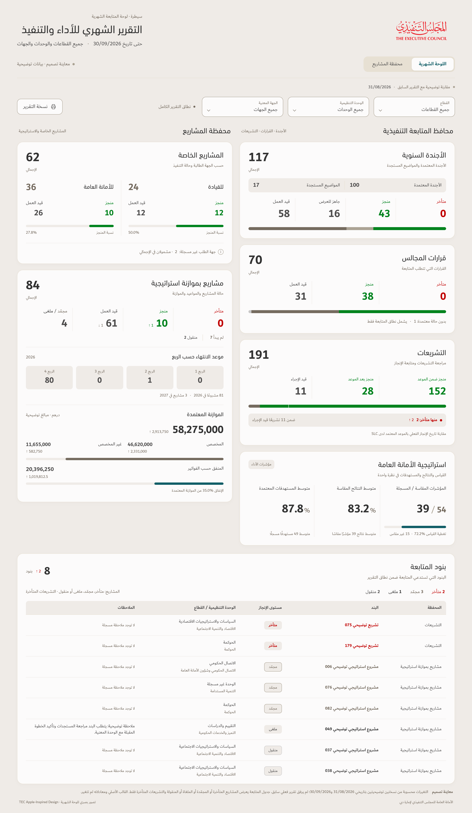

# TEC Apple-inspired illustrations — status colours and follow-up order

| Illustration | Full-size image | PDF |
| --- | --- | --- |
| Projects | [View](Projects-Dashboard-TEC-Apple-Status-Colors.png) | [Download](Projects-Dashboard-TEC-Apple-Status-Colors.pdf) |
| Monthly report | [View](Monthly-Dashboard-TEC-Apple-Status-Colors.png) | [Download](Monthly-Dashboard-TEC-Apple-Status-Colors.pdf) |

## Status colours

| Status | Colour |
| --- | --- |
| Completed — including legislation completed after its deadline | Green `#01831E` |
| Late, unfinished and past its deadline | Red `#C00000` |
| Frozen / مجمّد | Taupe text `#756B5F`, stone marker `#ABA394` |
| Cancelled / ملغى | Charcoal `#333333` |
| Transferred / منقول | Grey text `#4F4E4E`, silver marker `#C8C7C7` |
| In progress | Taupe `#756B5F` |
| Not started | Burgundy `#651D32`; an overdue open item is shown as late in red in the follow-up table |

The green and red are the exact semantic colours already used by the supplied Saytara mold and the app's monthly RAG indicators. TEC's teal remains the brand accent and the colour for quantitative/type charts; it is no longer the blanket colour for follow-up item names. Names now match the displayed status colour, with readable text shades for the lighter grey/stone markers.

The Legislation card shows **152 completed within the deadline** and **28 completed after the deadline** in green. The two segments retain their exact widths and a thin paper separator. The **2 unfinished overdue items**, within the 11 in progress, are red. Completed late legislation is not included in the unfinished-late count. The SLC explanation remains once at the bottom.

## Follow-up tables

Rows appear in the requested sequence: **late → frozen → cancelled → transferred**. Source order is preserved within each group. Projects qualify if they are frozen, cancelled or transferred, or if they are active/not started with a valid deadline before the report cutoff. A comment alone, or being not started before the deadline, does not qualify. Cancellations and transfers qualify even without comments. Each project appears once.

The illustrative projects table contains **6 projects: 3 frozen, 1 cancelled and 2 transferred**. There are no unfinished overdue projects at its **30/09/2026** cutoff. The previous illustrative snapshot also has 6 qualifying projects, so this table has no change arrow. The monthly table includes the same 6 projects plus **2 overdue legislation items**, for **8 items**; the earlier sample has 6, so **↑2** remains. This changes the projects table's view selection, not the source records or other dashboard totals.

Recorded completion percentages, other derived ↑/↓ changes, financial amounts, chart scales, the legend rule, Strategy placement, «الأجندة المعتمدة», «المواضيع المستجدة» and «الموازنة المعتمدة» are preserved. Empty status and H/M/L groups remain hidden. The source status enum is preserved; «مجمّد» is the displayed label for its frozen/suspended category.

These are standalone design previews using the same explicitly illustrative current and previous snapshots dated **30/09/2026** and **31/08/2026**. They do not represent operational historical changes. The original workbook, formulas, current preview fixture and released v122 app are unchanged.

Native renders and independent checks confirmed the selection from all 84 scoped projects, deadline boundary cases, inclusion without comments, row sequence, exact colours, unchanged aggregate figures and chart widths, valid comparison badges, TEC fonts, Arabic/RTL and absence of checked clipping, overflow or runtime errors. Projects retain 31 nonzero change badges; the monthly report retains 8. PNG sizes are **2880 × 6906** and **2880 × 4954**. Each PDF contains the complete composition on one page for zoomable review. Hashes are in `SHA256SUMS`.

