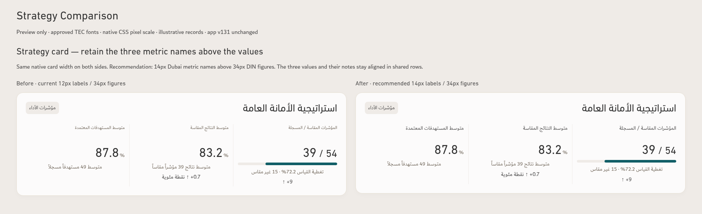
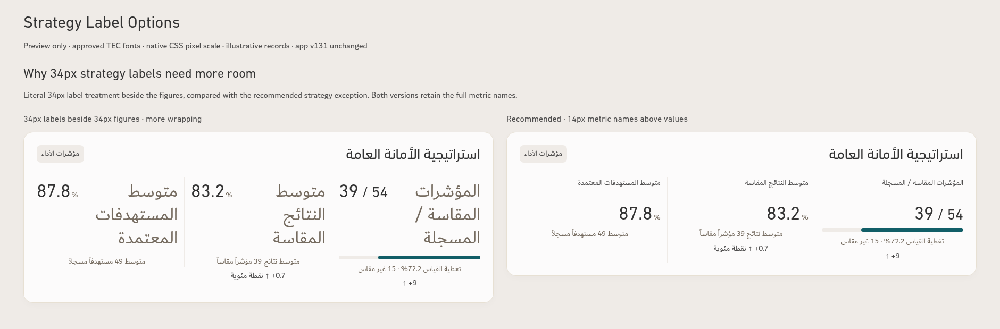
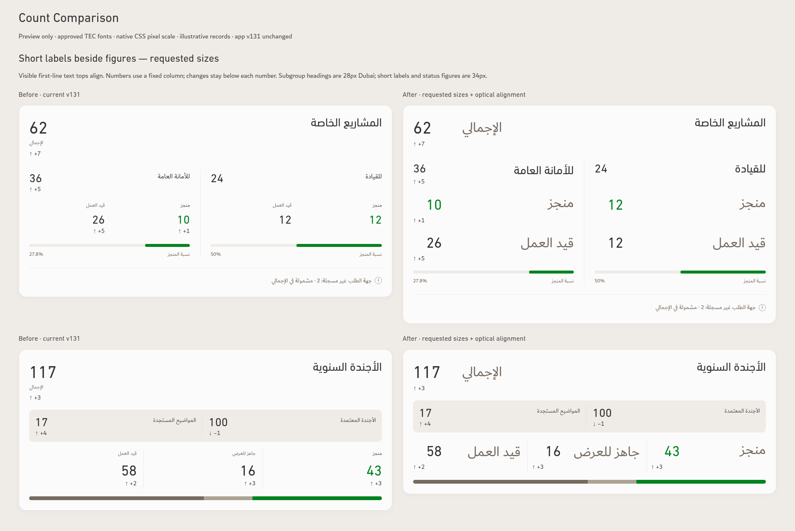
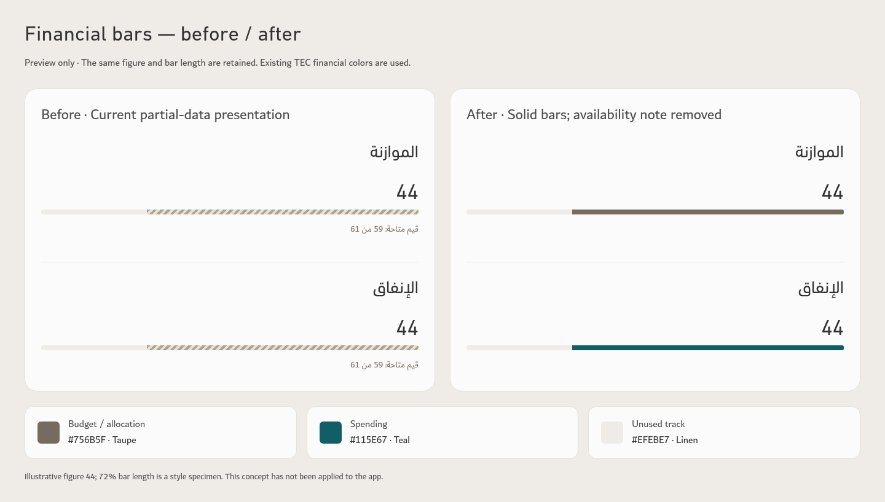

# Typography, strategy and financial-bar review

**Preview only. The app, v131 ZIP and current design standard are unchanged.**

[Download complete preview ZIP](https://github.com/ormbh/Performance-App-2/raw/refs/heads/main/TEC-Typography-Alignment-Concept.zip)

The supplied screenshot prompted a separate treatment for the strategy card: its three long metric names describe different measures and should stay above their figures. The recommended preview uses **14px Dubai Regular metric names above 34px DIN Next LT Arabic Regular values**. The literal 34px beside-number version is also shown so the wrapping tradeoff is visible.

| Element | Current screen | Requested / proposed screen | Font — Regular |
| --- | --- | --- | --- |
| Special-project subgroup totals, 24 / 36 | 28px | 28px retained | DIN Next LT Arabic |
| Agenda status figures, 43 / 16 / 58 | 34px | 34px retained | DIN Next LT Arabic |
| Special-project status figures, 12 / 10 / 26 | 28px | **34px** | DIN Next LT Arabic |
| Subgroup names, للقيادة / للأمانة العامة | 16px | **28px** | Dubai |
| Short value/status labels, الإجمالي / منجز / قيد العمل | 12px | **34px requested**, beside figures | Dubai |
| Strategy metric names | 12px | **14px recommended**, above figures; 34px alternative shown | Dubai |
| Strategy primary figures, 39 / 83.2 / 87.8 | 34px | 34px retained | DIN Next LT Arabic |
| Strategy registered denominator, 54 | 28px | 28px retained | DIN Next LT Arabic |
| Supporting notes and percentage signs | 14px | 14px retained | Dubai |
| Change arrows and differences | 15px | 15px retained | Dubai |

An optional **18px short-label** comparison is included for numeric emphasis. It is an alternative to review, not a replacement for the requested 34px version.

## Strategy card — current and recommended

The three figures share a row; their metric names and notes occupy separate rows. RTL positions are retained: measured/registered at right, average results in the middle, average targets at left. Mobile stacks the three measures while retaining the font sizes.

## Strategy label alternatives

At a typical three-column card width, the 34px metric names require multiple lines beside the values. The recommended exception preserves complete names and a stable numeric row.

## Requested count-card typography

Short labels and numbers align by the visible tops of their first text lines. Dubai and DIN require small per-pair optical offsets; aligning their element boxes alone does not produce the same result. Numbers use a consistent column, with each change arrow directly beneath its number. The two special-project groups share heading, value and bar rows. Narrow/mobile layouts reflow into full-width status rows rather than shrinking text.

[Optional 18px short-label comparison](comparisons/short-label-options.png) · [Mobile strategy](comparisons/mobile-strategy-390.png) · [Mobile special projects](comparisons/mobile-special-390.png) · [Mobile agenda](comparisons/mobile-agenda-390.png).

## Financial bars — requested solid style

| Role | Before | Proposed | Color |
| --- | --- | --- | --- |
| Budget / allocation | Partial-value hatching | Solid fill | Taupe **#756B5F** |
| Spending | Partial-value hatching | Solid fill | Teal **#115E67** |
| Unused track | Linen | Retained | **#EFEBE7** |
| Financial value-availability note | قيم متاحة: 59 من 61 | **Removed**, with no replacement marker or note | — |

The same specimen figure 44 and the same 72% illustrative bar length are used on both sides. Neither is presented as an operational aggregate or a completeness percentage. Source calculations and exclusions do not change. The preview records the requested presentation removal for screen and print; it does not modify the app's current financial display. Previously approved Search, Navigation and Print concepts are retained.

## Preview verification

Native Chromium 151 screenshots at device scale 1 / 100% zoom. Approved fonts loaded; requested sizes measured. Desktop typography, full metric names, visible text-top alignment, arrow anchoring, shared numeric/bar rows and 390px mobile reflow checked. No card or page overflow and no browser errors. All v131 source files and release bytes match the recorded baseline.

Examples use the existing illustrative QA workbook; no operational workbook or uploaded report is included. This is a visual review, not a new app release or accessibility certification.

Extract the ZIP and open **index.html** to inspect the full preview; the static PNG comparisons are also included. [Render evidence](render-evidence.json).
