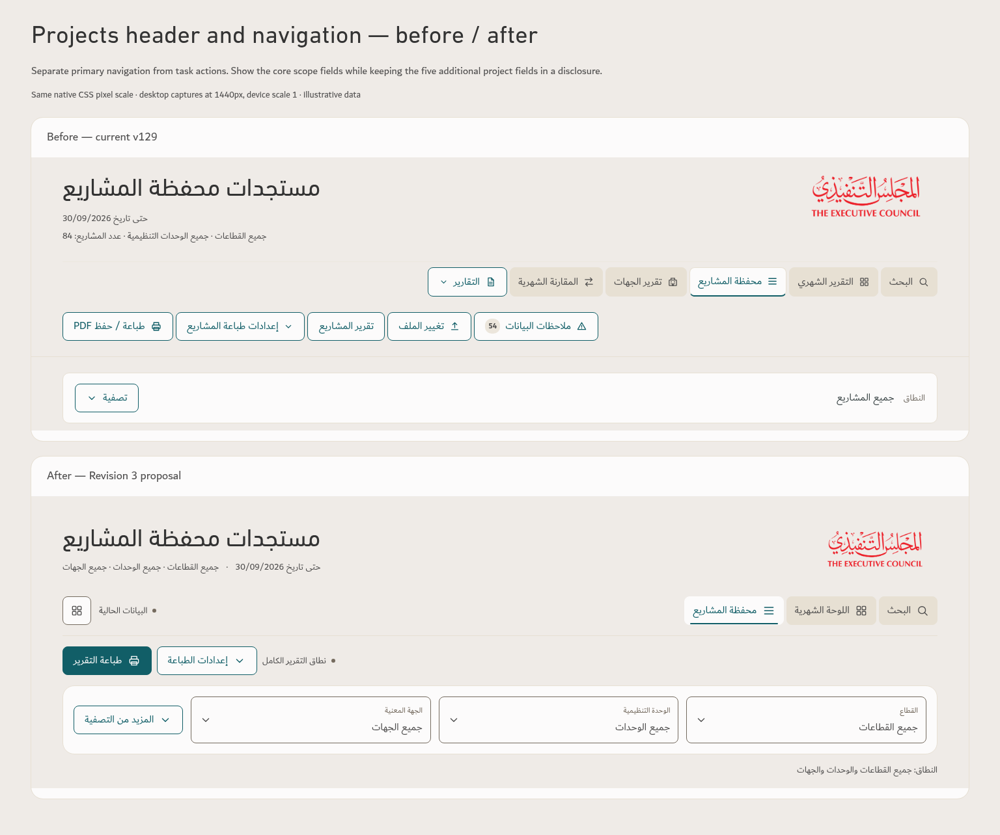
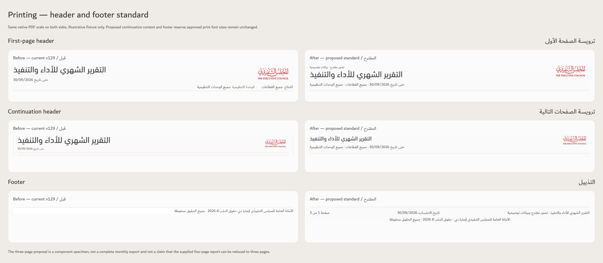

# TEC shared workspace standard — Revision 3 proposal

Prepared using the TEC Apple-Inspired Design skill. Approved DIN/Dubai typography, exact palette, statuses and source meanings are retained. This review adds a common setup for filters, menus, printing, buttons, icons, headers and footers; the released v129 app is unchanged.

[Complete standard: all tables and rules](../Design-Standard/Revision-3-Shared-Workspace-Proposal.md) · [Download interactive review pack](../TEC-Shared-Workspace-Standard-Review.zip) · [Native print specimen](print/TEC-Shared-Print-Proposal.pdf) · [Verification](VERIFICATION.md)

Extract the entire ZIP and open `index.html` to view all comparisons, specification tables and interactive examples with bundled fonts and logo.

| Component | Proposed common setup |
| --- | --- |
| Header | One masthead, three primary destinations and grouped app menu. Keep the approved Google search-home exception. |
| Filters | Visible sector/unit/entity; five project extras under «المزيد من التصفية»; live scope and filters-only reset. Label12px/value16px, minimum72px fields. |
| Menus | Paper shells,16px options,44px targets,12px corners; outside/Escape dismissal and correct focus. Modal filter sheets on mobile. |
| Buttons | Approved primary/secondary/icon recipes,16px Dubai,44px minimum,8px corners; complete hover/focus/pressed/disabled/loading states. |
| Icons | Existing20px outline SVGs with explicit names and44px action targets. |
| Printing | Direct print plus optional settings; full first header, compact continuation context and generated page/context footer. Body13.5pt; footer10.5pt. |
| Footer |14px Dubai Ink source/date/legal metadata; filename screen-only; exact definitions in a labelled disclosure. |

## Before and after

- [Monthly header](comparisons/header-monthly.png)
- [Projects header](comparisons/header-projects.png)
- [Expanded filters](comparisons/filters.png)
- [Filter popup](comparisons/filter-popup.png)
- [Menus](comparisons/menus.png)
- [Buttons, states and icons](comparisons/buttons-icons.png)
- [Print settings](comparisons/print-settings.png)
- [Footer and definitions](comparisons/footer.png)
- [Search header/footer](comparisons/search.png)
- [Printed first/continuation headers and footer](print/TEC-Print-Before-After.png)

The three-page PDF is a component specimen with frozen illustrative records, not the complete operational report or a target page count. The supplied operational PDF was inspected privately and is excluded from public previews.
