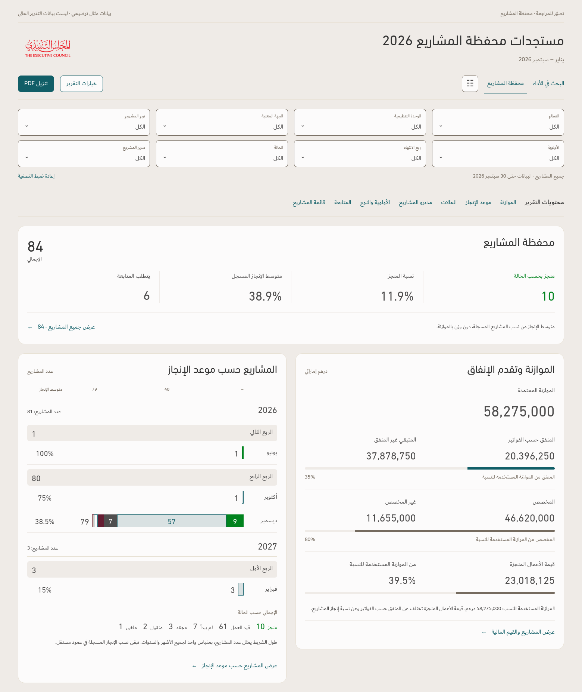

# محفظة المشاريع — full-page review

**Audit and illustration only · 15 October 2026 (Dubai).** The v166 application, release ZIP and approved design principles remain unchanged.

The available workbook has 84 project rows but no project titles, manager names or financial values. It therefore supplies **zero eligible named projects**, not the populated totals shown below. Every illustration is prominently marked as an example and uses a generated, anonymized fixture. No missing source values were filled with example data.

## Review the proposed page

- [Complete page](portfolio-full-page-proposal.png)
- [Title, filters, summary and principal charts](portfolio-overview-proposal.png)
- [Budget and deadline charts at readable size](portfolio-charts-proposal.png)
- [Status breakdown, compact definitions and manager analysis](portfolio-status-manager-proposal.png)
- [Priority/type count and budget charts](portfolio-priority-proposal.png)
- [Follow-up table](portfolio-followup-table-proposal.png)
- [Main project list and column order](portfolio-main-list-proposal.png)
- [Phone layout](portfolio-mobile-proposal.png)
- [Self-contained HTML illustration](review.html) — download and open locally; controls are review placeholders.

## Proposed treatment

Bring the overall total to the top; retain budget on the right and deadlines on the left. Change the deadline chart from equal-width monthly percentage bars to a shared project-count scale, preserving every year and quarter. Keep recorded progress, completed-project share, allocation, spending and work value distinct.

Use consistent status colors, readable counts inside bars when space permits, totals at the end of count bars, a compact portfolio-specific legend, hidden empty groups, zero as a dash and missing values as blank. Preserve all eight filters, the existing manager-ranking calculation, source notes and exact-record links.

Use the same leading RTL columns in both record tables:

**م ← المشروع ← الجهة المعنية ← الحالة ← نسبة الإنجاز ← موعد الإنجاز**

Append **ملاحظات** in the follow-up table. Keep project-specific context and populated manager/financial details available through the existing record views. Detailed-update cards remain exclusive to special projects.

Read the [audit and implementation checklist](Audit.md), [full design proposal](Proposal.md) and [verification evidence](evidence.json). These distinguish current behavior, proposed changes and checks that still require implementation and a complete operational workbook.
