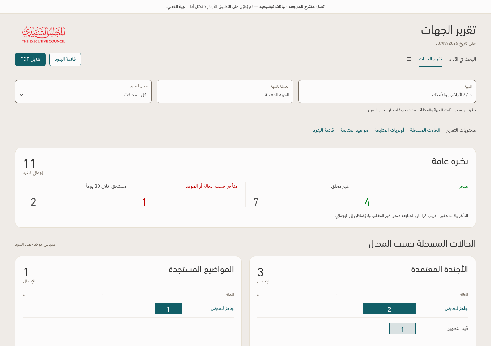

# تقرير الجهات — audit and full-page illustration

**Review stage only · 15 October 2026 (Dubai) · v167 remains the production baseline.** Implementation awaits approval. The clean application ZIP and current approved design principles are unchanged.

All populated visuals use a separately loaded anonymized fixture. They do not assess the named entity's operational performance. The available attachment contains 343 agenda/council/special-project rows with blank titles and supplies zero eligible named entity rows.

- [Complete desktop page](entity-full-1560.png)
- [Overview](entity-overview.png) · [Four domain charts and compact legend](entity-charts.png)
- [Follow-up table](entity-followup.png) · [Grouped main tables](entity-tables.png)
- [Phone layout](entity-full-390.png)
- [Self-contained HTML proposal](review.html) — download and open locally; domain filtering and in-page links work, while entity/relationship context is fixed and PDF navigation is illustrative.
- [Audit, recommendations and implementation approach](Audit.md)
- [Focused verification evidence](evidence.json)

The proposal removes repeated status views, keeps recorded statuses distinct from date-based alerts, aligns table columns and section order, and retains source-specific scope. The proposed PDF must use the same scoped content and readable continuation rules after implementation is approved.
