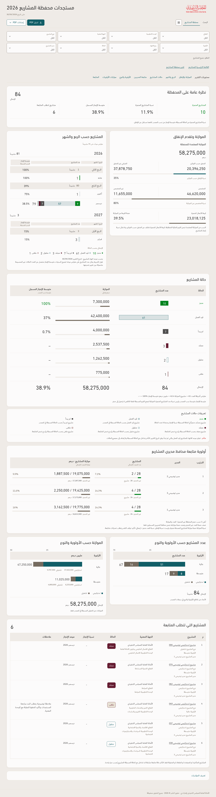

# محفظة المشاريع — implemented in v167

The approved full-page proposal and audit fixes are applied to the app and native PDF. The data, scoped navigation, Arabic layout and pagination checks are recorded in the [release verification](../Verification-v167.md).

**All populated examples below use an anonymized illustrative workbook.** The available attachment has 84 raw rows but no project names, managers or financial values, so it supplies zero eligible named portfolio projects. Example values were not copied into the attachment.

- [Actual desktop page](portfolio-screen.png) · [Phone layout](portfolio-mobile.png)
- [Actual native A4 PDF — illustrative data](portfolio-illustrative-a4.pdf)
- [Full project list — illustrative A4 PDF](portfolio-main-list-illustrative-a4.pdf)
- [PDF verification](PDF-verification.md)
- [Original approved proposal and audit](../../archive/v166/docs/portfolio/README.md)

The app retains all eight filters and exact-record links. The summary, financial values, count-scaled schedule, status definitions, manager analysis, priority charts and follow-up records use the same source scope in screen and PDF. Tables use the shared column order and preserve full notes; optional report notes appear at the end.
