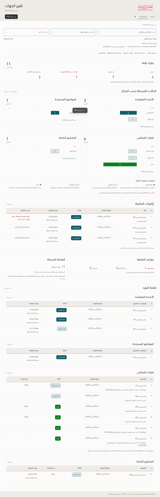

# تقرير الجهات — implemented in v168

The approved audit and full-page illustration are applied. The live page and native PDF use matching scope, section order, statuses, table fields and source records.

**Populated examples below are illustrative.** The available attachment has 343 raw entity-domain rows with blank item names, so it supplies zero eligible named entity rows. The example does not assess the named entity's actual operational performance.

- [Actual desktop page](entity-screen.png) · [Phone layout](entity-mobile.png)
- [Status charts and compact legend](entity-charts.png) · [Follow-up table](entity-followup.png)
- [Actual native A4 PDF — illustrative data](entity-illustrative-a4.pdf)
- [A4 page 1](entity-a4-page-1.png) · [A4 page 2](entity-a4-page-2.png)
- [Implementation and verification](../Verification-v168.md) · [Machine-readable evidence](../checks/entity.json)
- [Original approved audit and illustration](../../archive/v167/docs/entities/README.md)

The selected example contains 11 source rows: 3 approved agenda, 1 emerging topic, 6 recorded council decisions and 1 special project. Four are completed; seven are open. One is date-late and two are due on the report date; these alerts are not additional total components. The ready source status is preserved.

