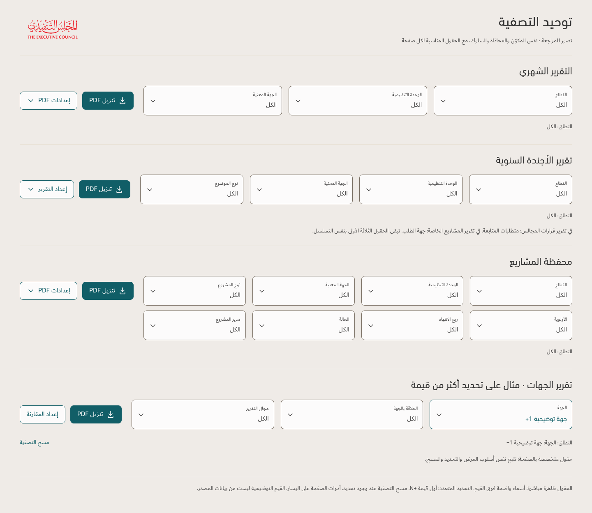
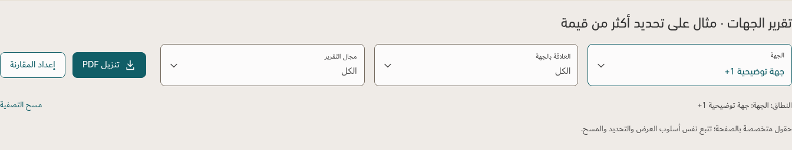

# Shared desktop filter proposal

Illustration only. The v172 app and principles have not been changed. All displayed example selections are invented, with no uploaded workbook content.

One filter component with common label/value hierarchy, spacing, selection summary, reset wording and keyboard behavior. Main filters remain visible. Organizational fields keep the same order where applicable; each page retains its relevant extra fields. PDF and page-specific actions align at the left. Scope/reset follow the field rows.

The three detailed reports share sector, unit and concerned entity, followed by topic type / follow-up requirements / requester respectively. Portfolio retains all eight fields. Entity retains its three specialized fields and comparison command. Search/comparison detail filters remain local to the relevant records and share terminology and control styling.

The illustration shows appearance only; controls do not filter data. No charts, summaries or legends are added by this proposal. Source scope and report calculations remain governed by the approved metric definitions.
