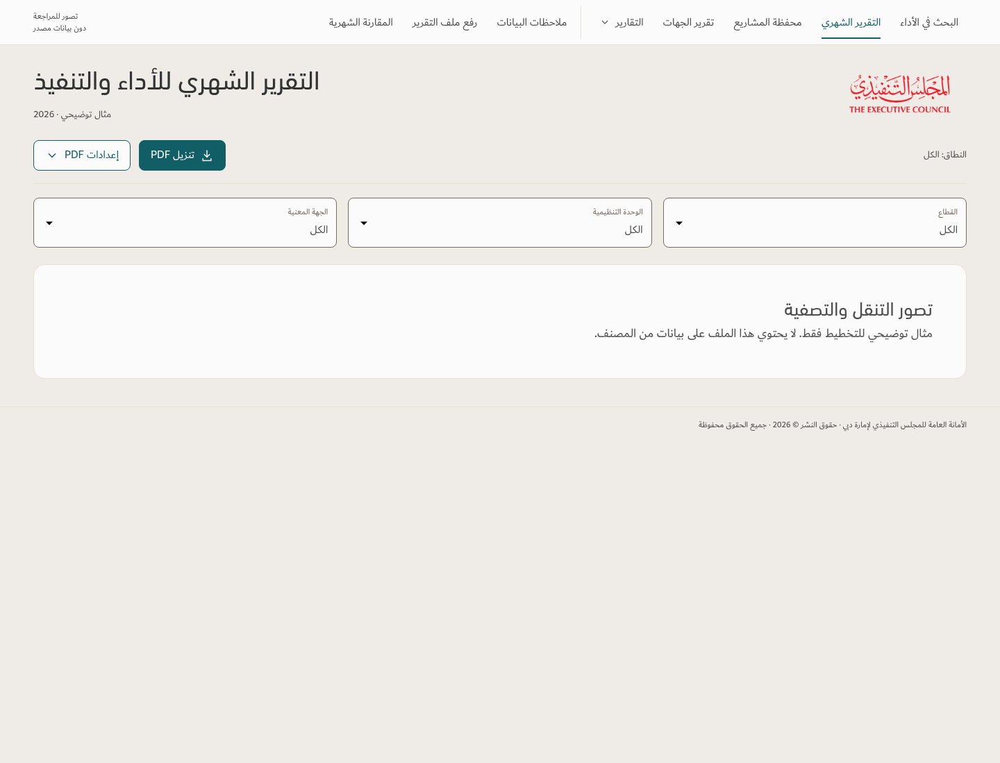
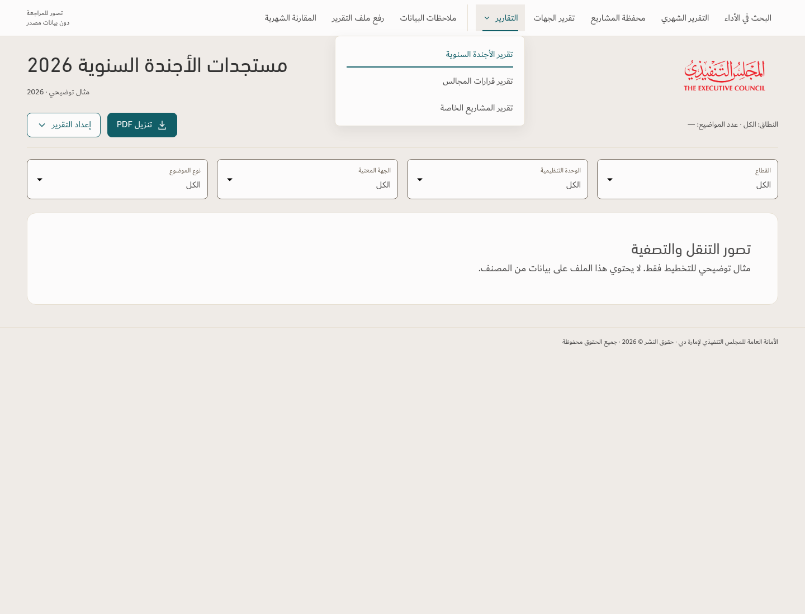
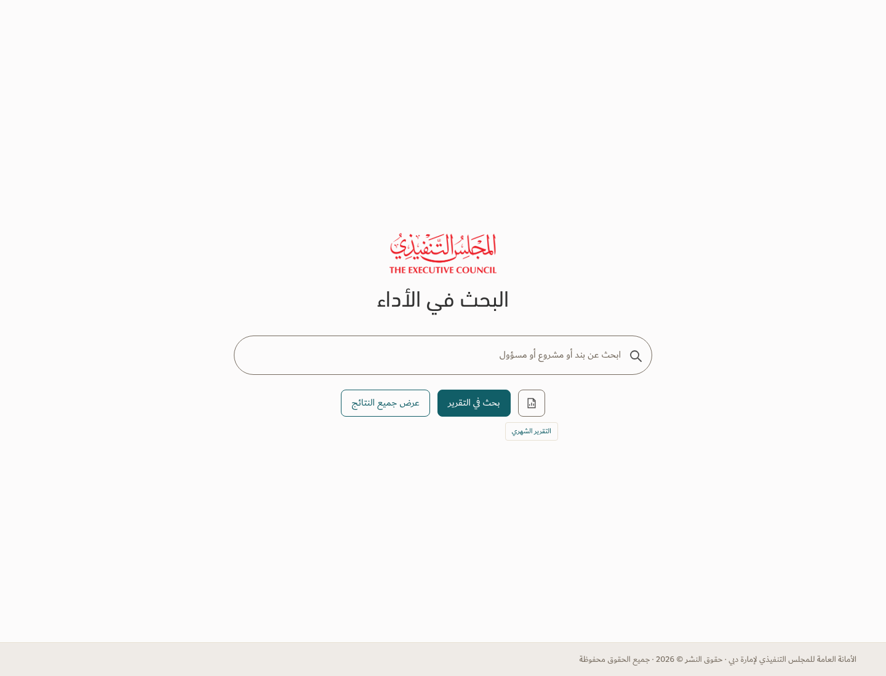

# Navigation preview — review only

Sanitized desktop illustrations of the proposed sticky text navigation, three-report dropdown, aligned PDF/filter controls, and search-page shortcut to the monthly report. No workbook records or audit data are included. The production app and design principles have not been changed.

[Download the interactive preview](Navigation-Preview.zip). Extract the ZIP and open `index.html` in a desktop browser. Navigation is interactive; filter/PDF controls are illustrative.

## Sticky navigation and controls

## Three-report dropdown

## Search shortcut

