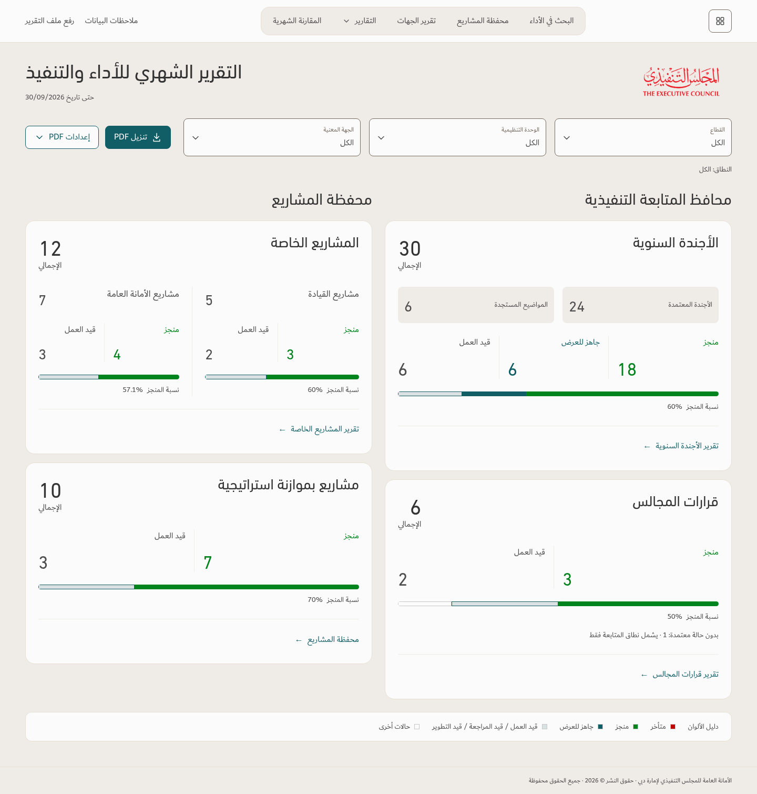
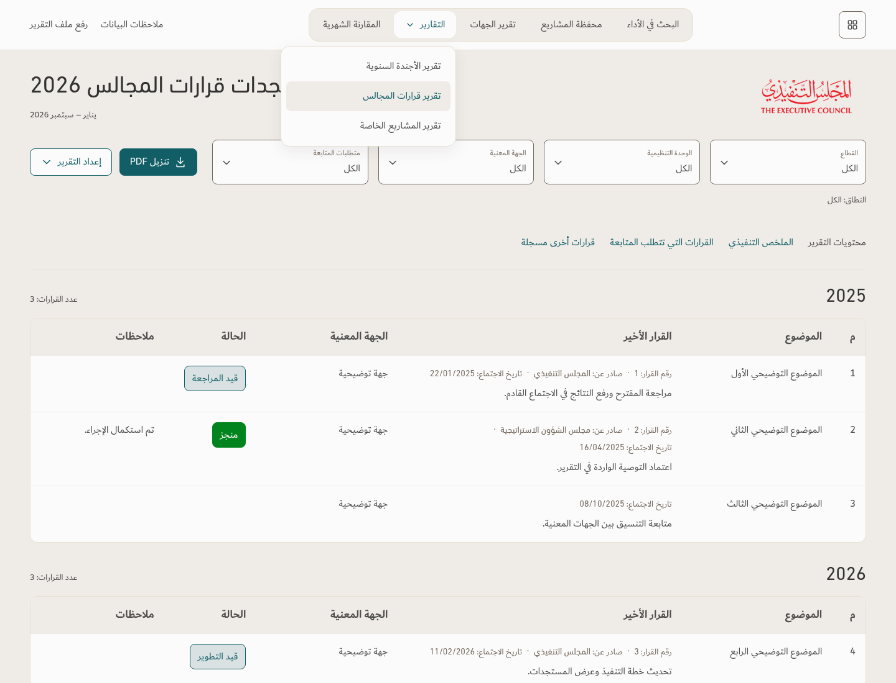
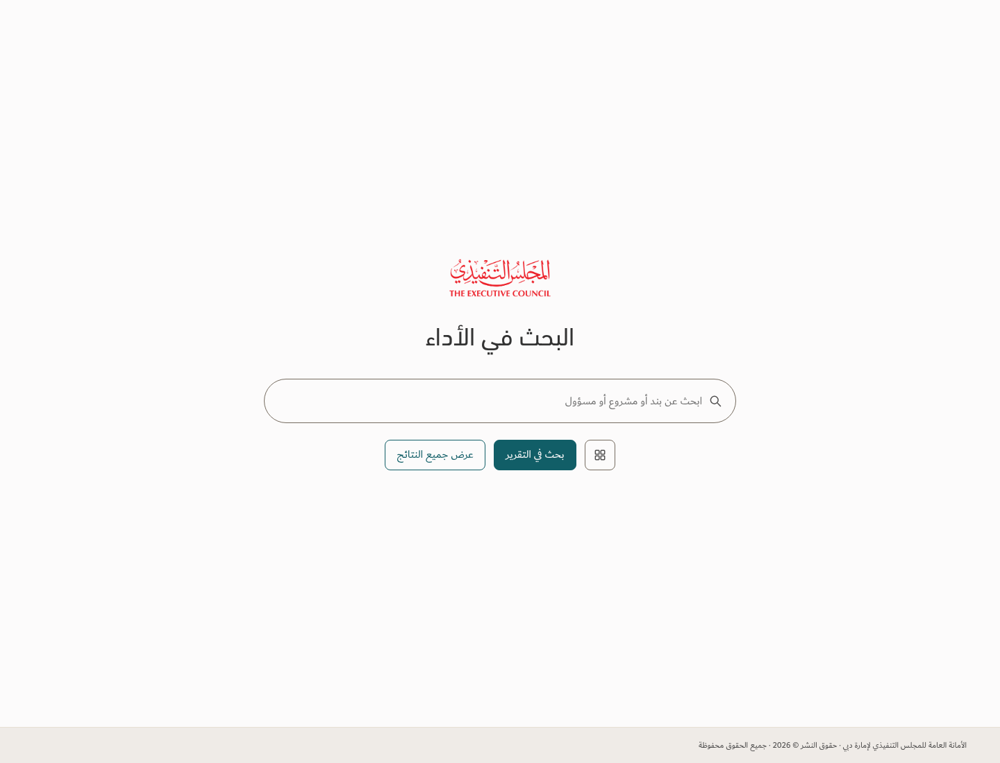
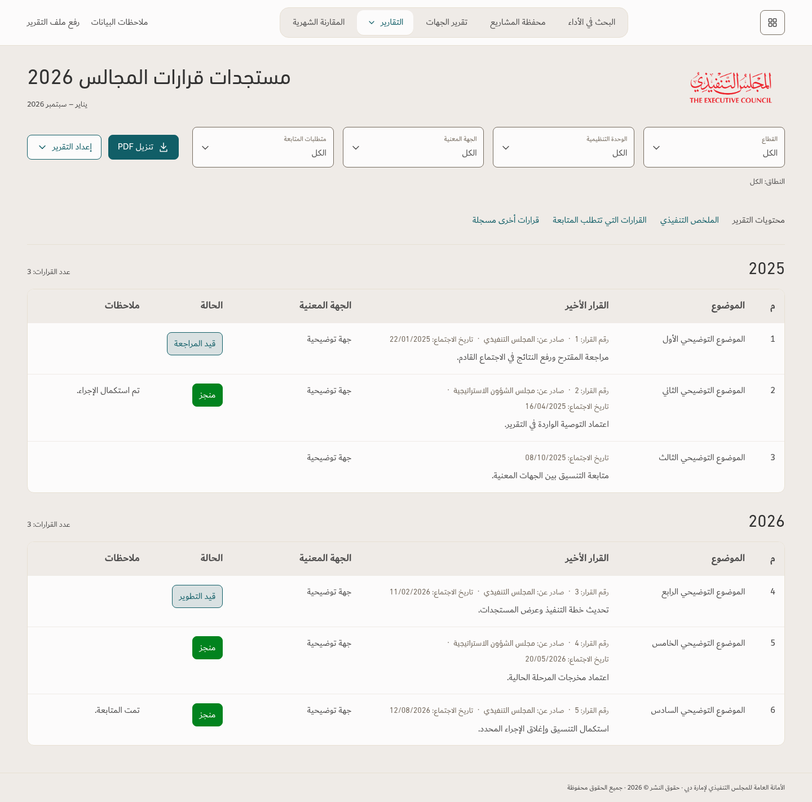
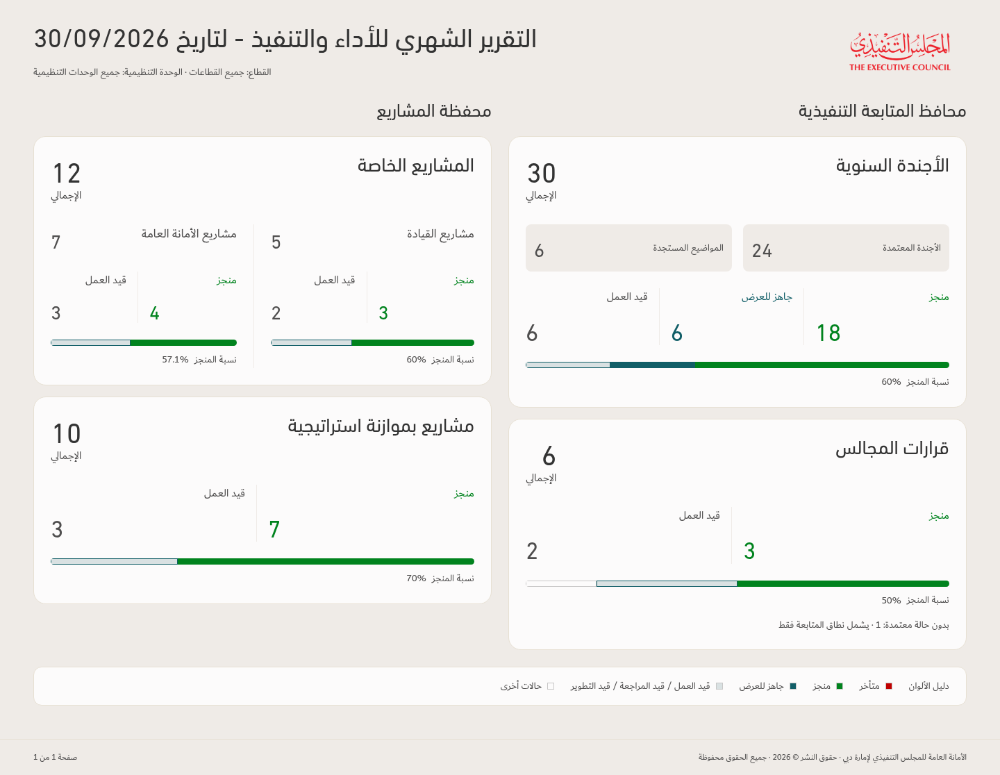

# Desktop navigation review — revision 2

Design illustration only. The delivered application and design principles have not been changed. All example records and counts are invented; no uploaded workbook data is included.

This revision preserves the original four-square icon, without a caption, as the monthly-report shortcut. It proposes a restrained sticky navigation capsule, a three-report dropdown, and aligned filters/PDF actions. Existing TEC fonts, logo and palette are retained.

[Download the interactive illustration](Navigation-Review-r2.zip). Extract the ZIP and open `index.html` in desktop Chrome or Edge. This is a local review prototype; filters and export buttons do not operate on report data. Other page destinations demonstrate header alignment only.

## Navigation and alignment

## Three-report menu

## Original search shortcut

## Council table structure

One logical table per year, rows ordered by quarter/date. Six columns remain unchanged. Decision metadata is omitted individually when empty. This illustration shows the table structure only; it does not replace the approved council charts or other existing report content.

The monthly illustration uses four sample cards to demonstrate navigation and PDF inclusion. It does not propose removing legislation, KPI, strategy or any other existing monthly content.

## Monthly PDF content boundary

Card data remains; screen navigation links, captions and arrows are absent. This is an illustrative PDF-content view, not an application-generated PDF. Open `index.html#monthly-pdf` in the extracted prototype to inspect it.

