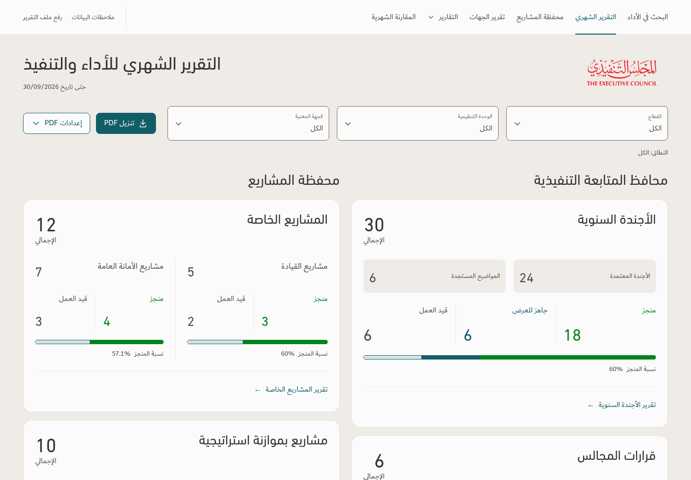
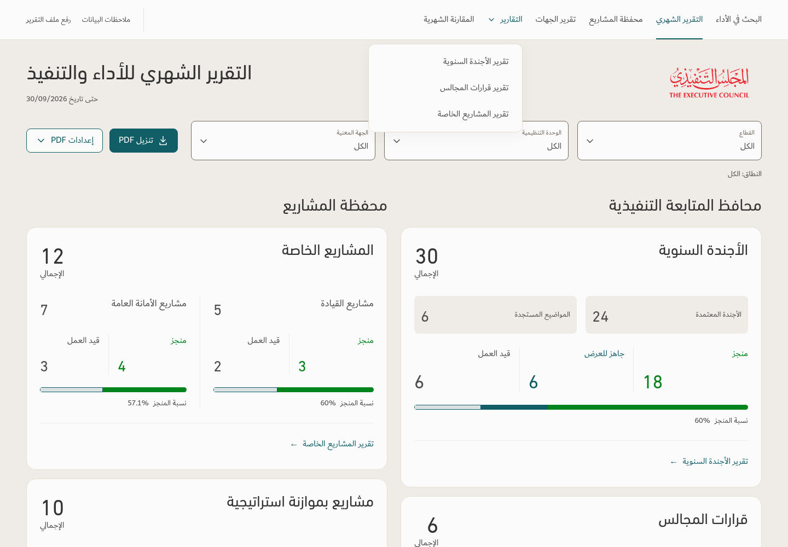
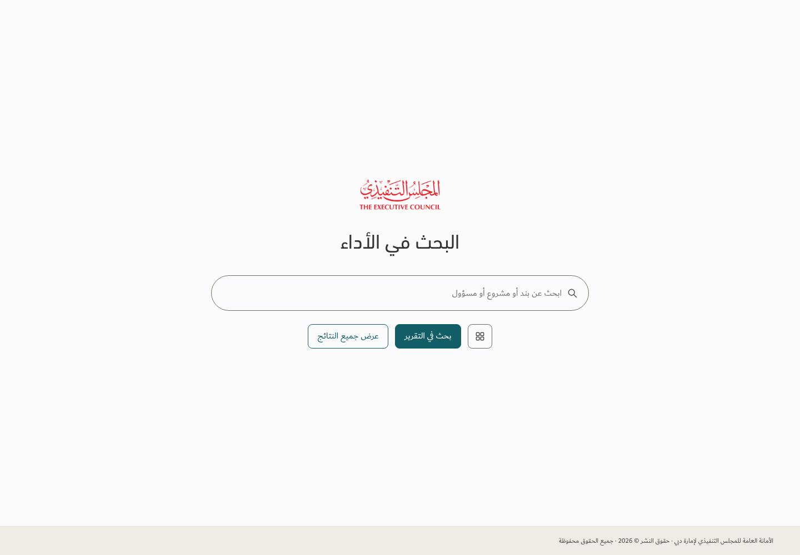

# Desktop navigation — revision 3

Illustration only; the application is unchanged. Invented example counts. Existing report content is not being removed or redesigned.

The four-square shortcut appears ONLY on the search landing page and opens the monthly report. All loaded pages use text navigation, including التقرير الشهري. No grid icon or enclosing capsule in the header. The three reports retain their dropdown. TEC fonts, palette and logo are retained.

[Download interactive illustration](Navigation-Review-r3.zip). Extract and open index.html. Filter/export buttons are illustrative. Other routes demonstrate the shared header only.
